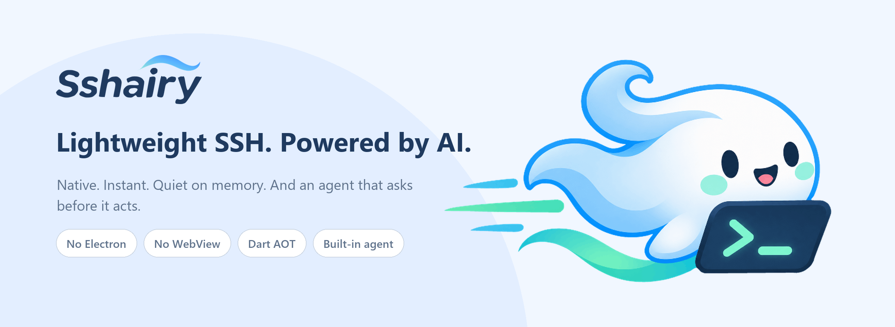
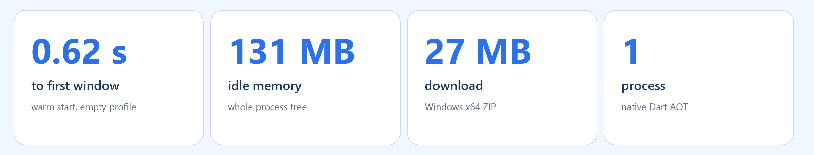
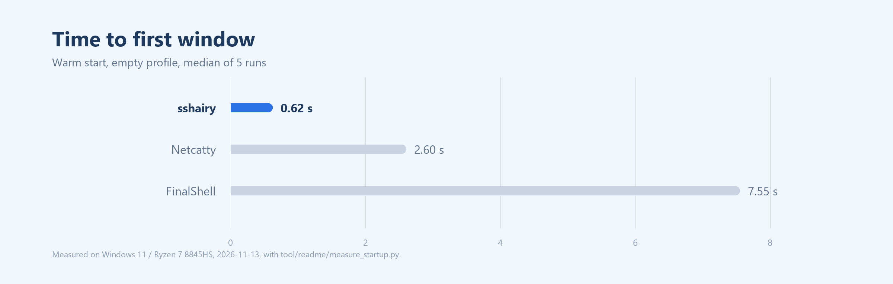
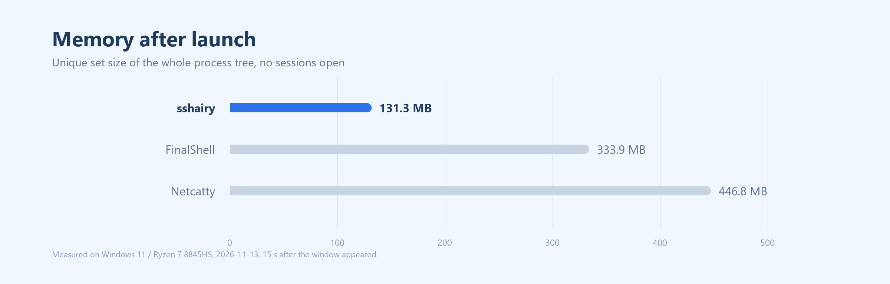
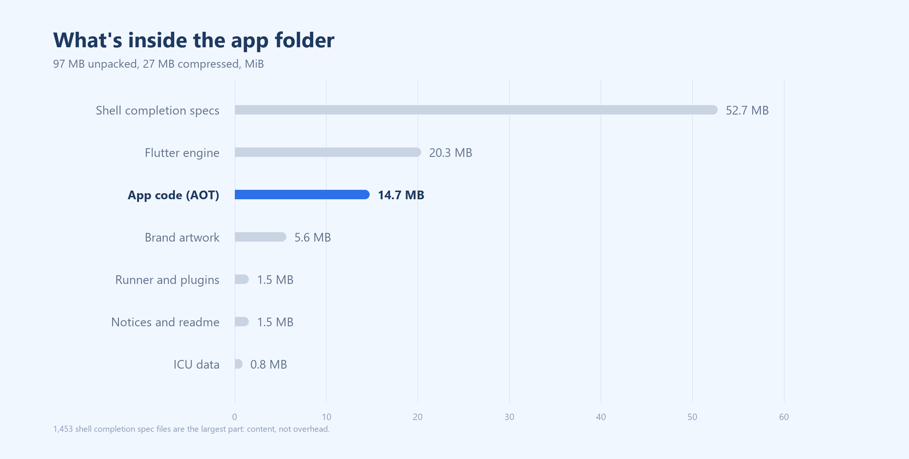

<p align="center">
  <picture>
    <source media="(prefers-color-scheme: dark)" srcset="media/hero-dark.png">
    
  </picture>
</p>

sshairy is a desktop SSH client that treats your RAM and your attention as scarce. It is written in Dart, compiled ahead of time and drawn by Flutter's own engine — the model of a native app, not a browser in a trench coat. It opens its window in about half a second, idles at roughly 131 MB, downloads as a 27 MB zip and runs as a single process.

It also ships with **Airy**, an agent that can inspect a server, read the terminal, move files and run commands — after showing you exactly what it is about to do.

<p align="center">
  <picture>
    <source media="(prefers-color-scheme: dark)" srcset="media/stats-dark.png">
    
  </picture>
</p>

## Why another SSH client

Most "modern" SSH clients are web apps in a desktop shell. They bundle Chromium, Node.js and a renderer, then spend the first two seconds of every launch booting a browser so that you can type into a terminal.

sshairy takes the native route: AOT-compiled Dart for the app, Flutter's Skia/Impeller renderer for pixels, and no web runtime anywhere in the package. The result is a client that feels like a system utility — it is there before your hands leave the keyboard, and it stays out of the task manager.

<p align="center">
  <picture>
    <source media="(prefers-color-scheme: dark)" srcset="media/hosts-dark.png">
    
  </picture>
</p>

## What is inside

- **Host library** — groups, tags, pins, search, recent connections, password and key auth, Ed25519 key generation.
- **Terminal** — tabs, splits, search, copy/paste, reconnect, restored layout. Closing a tab never closes the other channels.
- **SFTP** — dual-pane browser, queue, conflict handling, external editor, uploads from the terminal.
- **Port forwarding** — local, remote and dynamic forwards with running-forward status.
- **Server monitor** — CPU, memory and disk from `/proc`, without installing anything on the server.
- **Snippets** — searchable, tagged, insert or run with an explicit confirmation that dies with the connection.
- **Command completion** — 1,453 shell completion specs bundled, so the completion popup knows real commands, flags and paths.
- **Credentials** — passwords and keys live only in the OS secure store. Host keys are pinned on first use and a changed key blocks the connection until you replace it.
- **Six themes, each in light and dark** — Ice Blue · Mint, Mint Green, Violet, Sunset Orange, Deep Sea Blue, Sakura Pink. English and Chinese UI, with a renderer switch if you want Impeller.

## An agent with brakes

Airy is not a chat box bolted onto a terminal. It drives a fixed catalog of **39 typed tools** through the same `CapabilityDispatcher` the command palette uses — it can list hosts, read screens, run diagnostics, start commands, transfer files, edit settings and manage forwards, but it cannot invent a capability that does not exist.

Every approval is bound to the exact arguments, the target host route and the current model. If any of them change, the approval is void. Four permission modes:

| Mode | What it does |
|---|---|
| Observe | Read-only tools; you approve reads |
| Confirm | You approve reads and commands — the default |
| Auto confirm | A second model reviews each action and asks you when it is unsure |
| Full auto | Reads, commands and result sharing run without a prompt |

Secrets never enter the conversation. Commands run in the visible terminal, and only a bounded projection of their output is sent back to the model.

<p align="center">
  <picture>
    <source media="(prefers-color-scheme: dark)" srcset="media/agent-dark.png">
    
  </picture>
</p>

<p align="center">
  <picture>
    <source media="(prefers-color-scheme: dark)" srcset="media/approval-dark.png">
    
  </picture>
</p>

## Fast by construction

Two clients measured on the same machine, same empty profile, same warm cache. sshairy does not win by tuning — it wins by not loading a browser.

<p align="center">
  <picture>
    <source media="(prefers-color-scheme: dark)" srcset="media/start-dark.png">
    
  </picture>
</p>

<p align="center">
  <picture>
    <source media="(prefers-color-scheme: dark)" srcset="media/memory-dark.png">
    
  </picture>
</p>

<p align="center">
  <picture>
    <source media="(prefers-color-scheme: dark)" srcset="media/architecture-dark.png">
    
  </picture>
</p>

<p align="center">
  <picture>
    <source media="(prefers-color-scheme: dark)" srcset="media/download-dark.png">
    
  </picture>
</p>

Most of the on-disk size is not code: 1,453 shell completion specs are the largest single piece of the 97 MB folder, and the whole download compresses to 27 MB.

<p align="center">
  <picture>
    <source media="(prefers-color-scheme: dark)" srcset="media/inside-dark.png">
    
  </picture>
</p>

## How it compares

Feature lists are from each project's own documentation in November 2026. Start time and idle memory were measured only for clients installed on the test machine; download sizes are public release files.

| Client | Built with | Built-in AI | Windows download | Start¹ | Idle RAM¹ | License |
|---|---|---:|---:|---:|---:|---|
| **sshairy** | Dart + Flutter (native) | Agent, 39 tools | **27 MB** | **0.62 s** | **131 MB** | open source, license TBD |
| Netcatty | Electron + React | Agent | 127 MB | 2.60 s | 447 MB | GPL-3.0 |
| Wave Terminal | Electron + Go | Wave AI | 156 MB | — | — | Apache-2.0 |
| Termius | Electron | Command AI, agent beta | 328 MB | — | — | proprietary |
| Tabby | Electron + Angular | no | 162 MB | — | — | MIT |
| electerm | Electron | Assistant with agent mode | 115 MB | — | — | MIT |
| FinalShell | Java, bundled JRE | no | — | 7.55 s | 334 MB | proprietary |
| MobaXterm | native | no | 42 MB | — | — | proprietary (free Home) |
| Xshell | native | no | 50 MB | — | — | proprietary (free Home) |
| WindTerm | C, native | no | 31 MB | — | — | partly open source |

¹ Measured 2026-11-13 on Windows 11, Ryzen 7 8845HS: median of 5 warm launches to the first visible window, then unique set size of the whole process tree 15 s after launch, no sessions open. sshairy and Netcatty were run from their own installs; FinalShell from a data-free copy of its install folder. Only the three installed clients have numbers; the rest were not downloaded or run.

## Build and run

Requires Flutter 3.47.9 / Dart 3.13.7 and Visual Studio's Desktop development with C++ workload on Windows.

```sh
flutter pub get
flutter run -d windows
```

Checks:

```sh
flutter analyze
dart run tool/check_imports.dart
flutter test
```

Package a portable Windows folder, ZIP and SHA256:

```powershell
./tool/package_windows.ps1
```

The whole folder is the app — do not copy the exe alone.

## Status

sshairy is young and honest about it. It is primarily built for its author, has hundreds of commits in its first days, and ships without guarantees.

- **Platforms:** developed and tested on Windows 11. macOS and Linux are goals, not verified builds yet.
- **Unsigned:** no installer, no auto-update; SmartScreen will warn.
- **AI is opt-in:** configure an Anthropic Messages or OpenAI-compatible endpoint in Settings. No key, no AI.
- **License:** not chosen yet. It will be open source, but do not assume MIT today.
- **Long sessions:** the idle figures above are after launch with no sessions. Memory under heavy multi-tab load is still being profiled.
- **Tests:** ~1,730 unit and widget tests; no CI yet.

## Reproduce the numbers

```sh
python tool/readme/measure_startup.py sshairy <empty-profile-dir> "build/windows/x64/runner/Release/sshairy.exe"
python tool/readme/fetch_release_sizes.py wavetermdev/waveterm Eugeny/tabby electerm/electerm
```

`measure_startup.py` redirects `USERPROFILE`, `APPDATA` and `LOCALAPPDATA` for the child process, so it never reads or writes your real profile. `fetch_release_sizes.py` reads the latest public GitHub release.

The screenshots are generated by `integration_test/readme_shots_test.dart` from made-up hosts, a local PowerShell session and a scripted stand-in for the model — no server is contacted and no real model answers.

<p align="center"><sub>English · <a href="README.zh.md">中文</a></sub></p>
