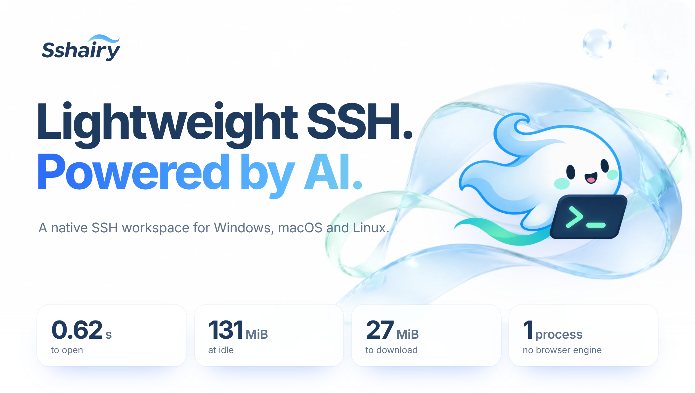
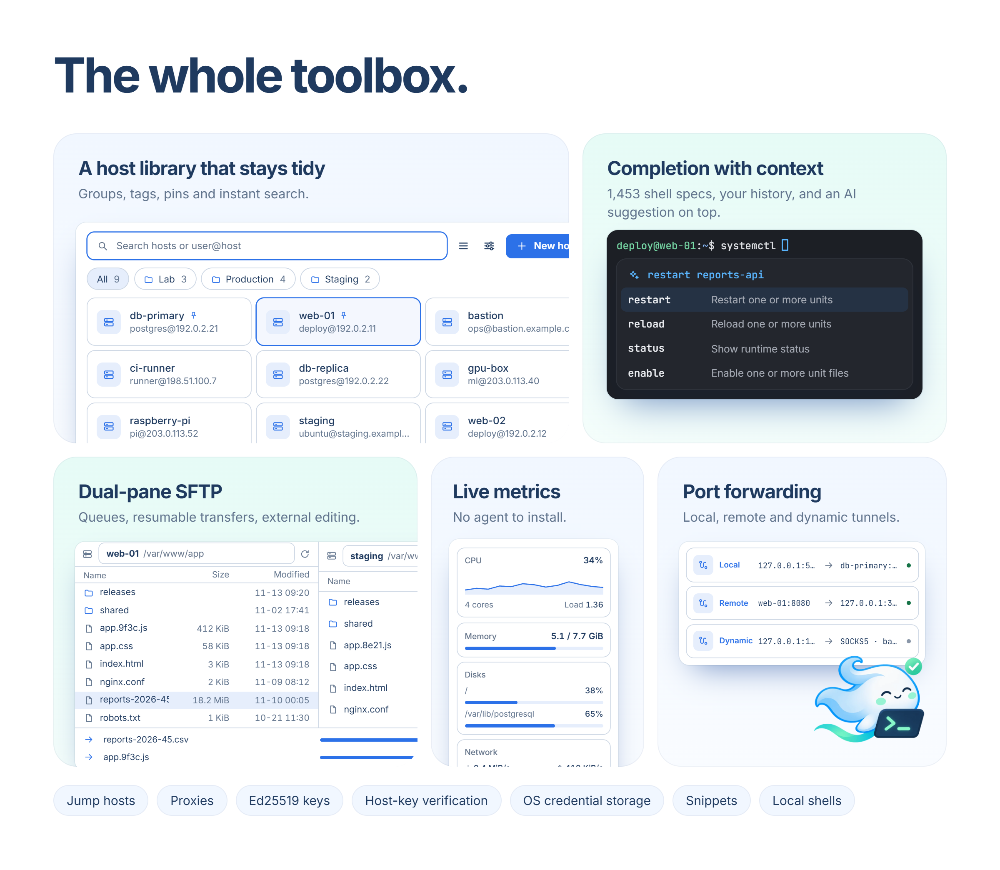
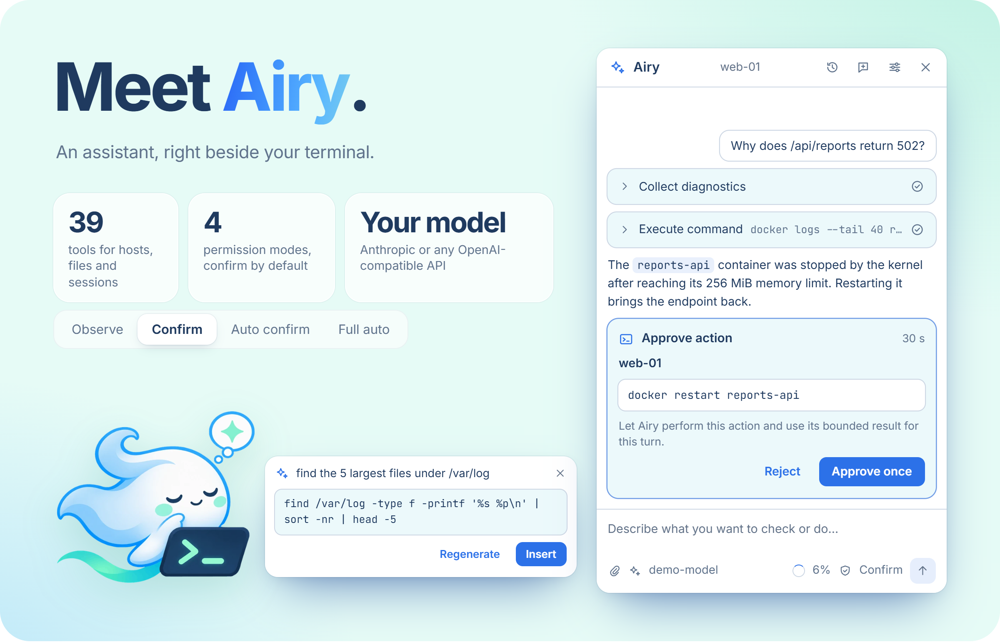

<div align="center">



[Features](#features) · [Airy](#airy) · [Themes](#themes) · [Performance](#performance) · [Get Sshairy](#get-sshairy) · [中文](README.zh.md)


[](https://flutter.dev)


</div>

**Sshairy** is a lightweight SSH client for **Windows, macOS and Linux**. Terminals, SFTP, tunnels and server monitoring share one clean native window, built with Dart and Flutter.

It is a complete SSH client first, with AI there when you want it. Stay in the terminal, hand Airy a task, or turn a sentence into a command. No Chromium, no WebView, no browser runtime to carry around.


## Features



| | |
|---|---|
| **Connect** | Hosts in groups with tags, pins and search. Password and key authentication, Ed25519 key generation, jump hosts and proxies. |
| **Work** | Tabbed terminals, draggable splits, local shells, search, reconnect and restored layouts. |
| **Move files** | Dual-pane SFTP, transfer queues, resumable file transfers, conflict handling and external editing. |
| **Keep watch** | CPU, memory, disk and process monitoring over SSH, with nothing to install on the server. |
| **Reach further** | Local, remote and dynamic port forwarding. Saved snippets and 1,453 shell completion specs. |
| **Stay in control** | Host-key verification and OS-backed credential storage. English and Chinese interfaces, customizable shortcuts. |

## Airy

Airy sits beside your terminal with **39 tools** for hosts, remote files, commands, sessions, layouts and settings. Bring your own Anthropic or OpenAI-compatible model and decide how much to delegate.

- **Agent** — describe a task and Airy works through it step by step.
- **Inline commands** — a plain-language request becomes a command you can edit before it runs.
- **AI completion** — suggestions as you type, next to shell specs and your history.

Four permission modes cover the range from watching to hands-off: **Observe**, **Confirm**, **Auto confirm** and **Full auto**. Confirm is the default, and every action shows its target and exact operation before you approve it.



## Themes

Ice Blue / Mint, Mint Green, Violet, Sunset Orange, Deep Sea Blue and Sakura Pink. Each palette carries through the interface, the terminal and Airy's artwork, in light and dark.


## Performance

**0.62 seconds to open. 131 MiB at idle.** Next to Netcatty, that is about **71% less idle memory** and a start about **4× sooner**.


<details>
<summary>All measurements</summary>

<!-- benchmark-table -->

| Client | Startup | Idle memory | App folder |
|---|---:|---:|---:|
| **Sshairy** | **0.62 s** | **131.3 MiB** | **97.4 MiB** |
| Netcatty | 2.60 s | 446.8 MiB | 471.8 MiB |
| FinalShell | 7.55 s | 333.9 MiB | 189.4 MiB |
| WindTerm | 1.33 s | 73.9 MiB | 75.8 MiB |
| electerm | 2.98 s | 414.6 MiB | 365.9 MiB |
| Wave Terminal | 2.34 s | 500.2 MiB | 616.1 MiB |
| Tabby | 1.91 s | 480.8 MiB | 481.4 MiB |
| Termius | 9.74 s | 1115.3 MiB | 557.8 MiB |
| MobaXterm | 3.54 s | 104.4 MiB | 47.1 MiB |
| Xshell | 3.01 s | 35.8 MiB | 102.6 MiB |

<!-- /benchmark-table -->

Method, versions and sources are in [tool/readme/SOURCES.md](tool/readme/SOURCES.md).

</details>

A **27 MiB download** unpacks to **97.4 MiB** and runs as **one native process**, with 1,453 shell completion specs included.


## Get Sshairy

Portable Windows builds are published on the [Releases](../../releases) page. Unzip and run `sshairy.exe` from the complete folder, next to its DLLs and `data` directory.

To build from source you need Flutter 3.47.9 / Dart 3.13.7. On Windows, also install Visual Studio's **Desktop development with C++** workload.

```sh
flutter pub get
flutter run -d windows
```

Package a portable Windows release:

```powershell
./tool/package_windows.ps1
```

<div align="center">

[English](README.md) · [中文](README.zh.md)

</div>
