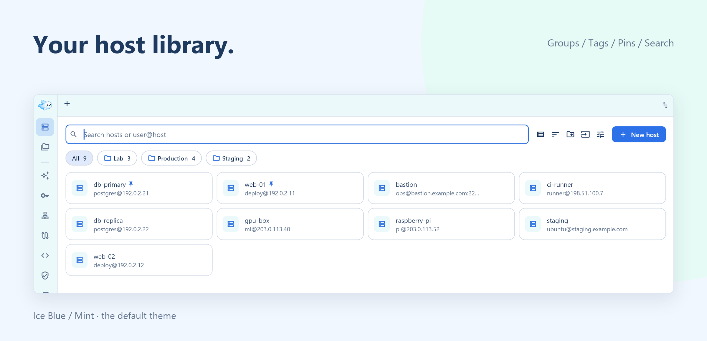
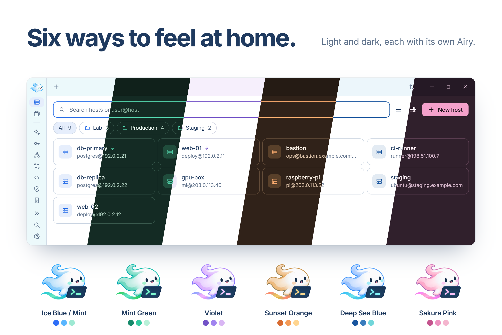
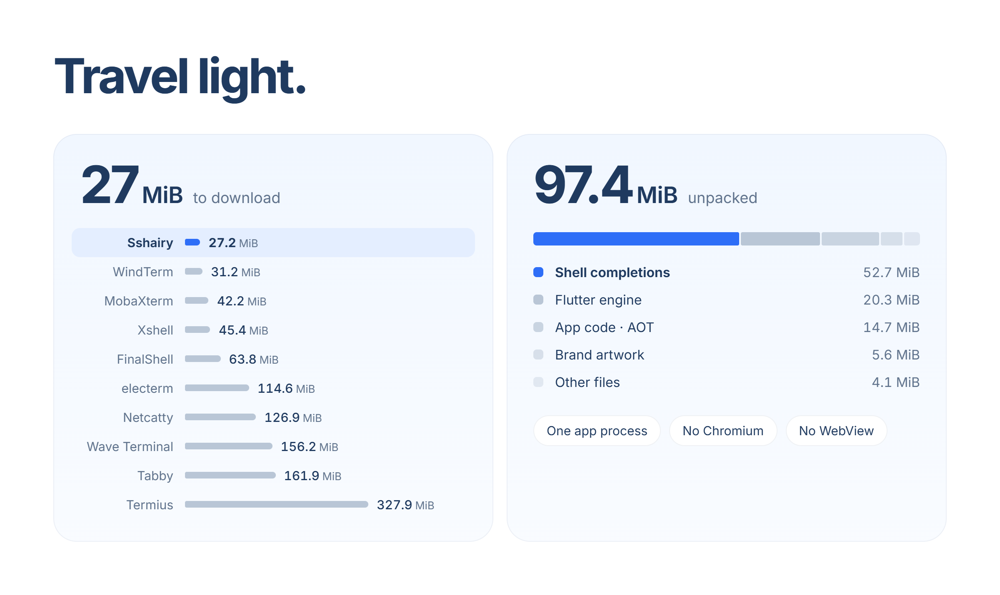

<div align="center">


[](https://flutter.dev)

[](README.md)
[](README.zh.md)


[Features](#features) · [Airy](#airy) · [Themes](#themes) · [Performance](#performance) · [Build](#build)

</div>

**Sshairy** is a lightweight SSH client for **Windows, macOS and Linux**. Terminals, SFTP, tunnels and server monitoring come together in a clean native interface, built with Dart and Flutter.

A full SSH client first, with AI to help along the way. Keep working in the terminal, ask Airy to handle a task, or turn a sentence into a command. No Chromium, no WebView, no browser runtime to carry around.



## Features

| | |
|---|---|
| **Connect** | Organize hosts with groups, tags, pins and search. Password and key authentication, Ed25519 key generation, jump hosts and proxies. |
| **Work** | Tabbed terminals, draggable splits, local shells, search, reconnect and restored layouts. |
| **Move files** | Dual-pane SFTP, transfer queues, resumable file transfers, conflict handling and external editing. |
| **Keep watch** | CPU, memory, disk and process monitoring over SSH. Nothing to install on the server. |
| **Reach further** | Local, remote and dynamic port forwarding. Saved snippets and 1,453 shell completion specs. |
| **Stay in control** | Host-key verification and OS-backed credential storage. English and Chinese interfaces, customizable shortcuts. |

## Airy

An assistant beside your terminal, with **39 tools** for hosts, remote files, commands, sessions, layouts and settings. Connect your Anthropic or OpenAI-compatible model and choose how much to delegate.

- **Agent** — describe a task and let Airy work through it.
- **Inline commands** — turn a plain-language request into an editable command.
- **AI completion** — get suggestions as you type, alongside shell specs and command history.

Four permission modes fit different workflows: **Observe**, **Confirm**, **Auto confirm** and **Full auto**. Confirm is the default, with the target and operation presented for approval.


## Themes

Ice Blue / Mint, Mint Green, Violet, Sunset Orange, Deep Sea Blue and Sakura Pink. Each palette carries through the interface, terminal and Airy artwork, with both light and dark appearances.



## Performance

**0.62 seconds to open. 131 MiB at idle.** Sshairy uses about **71% less idle memory** than Netcatty and opens about **4× sooner**.


<!-- benchmark-table -->

| Client | Startup | Idle memory | App folder |
|---|---:|---:|---:|
| **Sshairy** | **0.62 s** | **131.3 MiB** | **97.4 MiB** |
| Netcatty | 2.60 s | 446.8 MiB | 471.8 MiB |
| FinalShell | 7.55 s | 333.9 MiB | 189.4 MiB |
| WindTerm | 1.33 s | 73.9 MiB | 75.8 MiB |
| electerm | 2.98 s | 414.6 MiB | 365.9 MiB |
| Wave Terminal | 2.34 s | 500.2 MiB | 616.1 MiB |
| Tabby | 1.91 s | 480.8 MiB | 481.4 MiB |
| Termius | 9.74 s | 1115.3 MiB | 557.8 MiB |
| MobaXterm | 3.54 s | 104.4 MiB | 47.1 MiB |
| Xshell | 3.01 s | 35.8 MiB | 102.6 MiB |

<!-- /benchmark-table -->

A **27 MiB download**, **97.4 MiB unpacked**, and **one native app process**, with **1,453 shell completion specs** included.



## Build

Requires Flutter 3.47.9 / Dart 3.13.7. For Windows, install Visual Studio's **Desktop development with C++** workload.

```sh
flutter pub get
flutter run -d windows
```

Create a portable Windows release:

```powershell
./tool/package_windows.ps1
```

Run `sshairy.exe` from the complete release folder, alongside its DLLs and data directory.

<div align="center">

[English](README.md) · [中文](README.zh.md)

</div>
