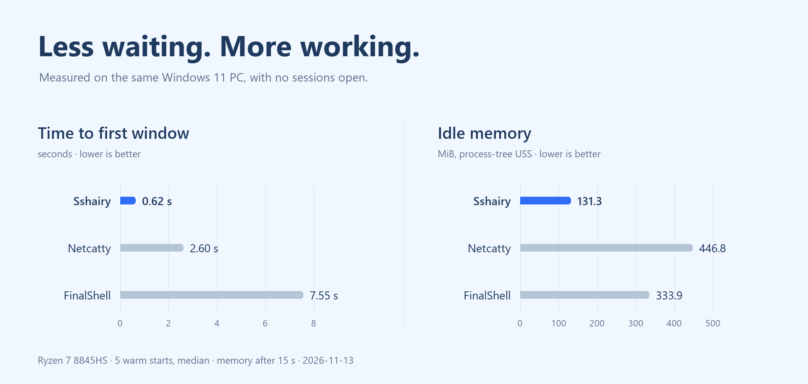

<div align="center">


[](https://flutter.dev)

[](README.md)
[](README.zh.md)


[Features](#features) · [Airy](#airy) · [Themes](#themes) · [Performance](#performance) · [Build](#build)

</div>

**Sshairy** is a lightweight, cross-platform SSH client for **Windows, macOS and Linux**, built with Dart and Flutter. Terminals, SFTP, tunnels and server monitoring share a modern native interface, without Chromium or WebView.

The idea is straightforward: make a good everyday SSH client, keep it quick and light, then let AI help with the work. SSH works independently; Airy adds an assistant, inline command generation and AI completion when you want them.

On our Windows test PC, it opens in **0.62 seconds**, with **131 MiB** of idle memory and a **27 MiB** download.


## Features

| | |
|---|---|
| **Connect** | Group, tag, pin and search hosts. Password and key authentication, Ed25519 key generation. |
| **Work** | Tabbed terminals, splits, local shells, search, reconnect and restored layouts. |
| **Move files** | Dual-pane SFTP, transfer queues, conflict handling and external editing. |
| **Keep watch** | CPU, memory and disk monitoring over SSH. Nothing to install on the server. |
| **Reach further** | Local, remote and dynamic port forwarding. Saved snippets and 1,453 shell completion specs. |
| **Stay in control** | Host-key verification before authentication; changed keys blocked by default. Passwords and private keys in the OS secure store. |

## Airy

Describe the task beside your terminal. Airy can inspect hosts, work with remote files, run commands and help with diagnostics, using **39 built-in tools**. Bring an Anthropic or OpenAI-compatible model; AI stays off until you configure it.

The default **Confirm** mode asks before an action runs. You see the target and the exact operation, and can approve or reject it. Choose **Observe** for read-only work, **Auto confirm** for review by a second model, or **Full auto** to allow actions without approval prompts within the scope you select.


Passwords and private keys stored by Sshairy are not sent to the model. Approved tools return bounded results; review the output you choose to share.

<sub>Interface images are crops of the running app with fictional hosts, a local PowerShell session and scripted model replies. No remote server is contacted in these demos.</sub>

## Themes

Ice Blue / Mint is the default. Five more palettes change the whole interface, with matching Airy artwork. Every theme also has a dark variant; the gallery below shows the light palettes.


## Performance

Quick to open and modest at idle. On the same PC, Sshairy used about **71% less idle memory** than Netcatty and reached its first window about **4× sooner**.



AOT-compiled Dart and Flutter keep the app native. The measured Windows build runs in **one app process** and unpacks to **97.4 MiB**. Its largest component is the bundled shell completion library.


<details>
<summary>Measurements, versions and other clients</summary>

Windows 11, Ryzen 7 8845HS, 24 GB RAM, 2026-11-13. Startup is the median of five warm launches, from process creation to the first visible window. Memory is the whole process tree's unique set size, 15 seconds after launch with no sessions open. Sshairy and Netcatty used isolated profiles; FinalShell used a copy of its installation without user data. These are startup and idle figures; active sessions can use more memory.

| Client | Built with | Built-in AI | Windows download | Startup | Idle memory |
|---|---|---|---:|---:|---:|
| **Sshairy 0.1.0** | Dart + Flutter | Airy agent | **27.2 MiB ZIP** | **0.62 s** | **131.3 MiB** |
| Netcatty 1.1.90 | Electron + React | Agent | 126.9 MiB portable EXE | 2.60 s | 446.8 MiB |
| FinalShell¹ | Java + bundled JRE | Not listed | — | 7.55 s | 333.9 MiB |
| WindTerm 2.7.0 | Native / C | Not listed | 31.2 MiB ZIP | — | — |
| electerm 5.10.0 | Electron | Assistant / agent mode | 114.6 MiB installer | — | — |
| Wave Terminal 0.14.5 | Electron + Go | Wave AI | 156.2 MiB EXE | — | — |
| Tabby 1.0.238 | Electron + Angular | Not listed | 161.9 MiB setup | — | — |
| Termius | Electron | Command AI / agent beta | 327.9 MiB installer | — | — |
| MobaXterm 26.6 | Native | Not listed | ~42.2 MB portable² | — | — |
| Xshell 8 build 0107 | Native | Not listed | ~49.9 MB installer² | — | — |

Only Sshairy, Netcatty and FinalShell were run. Other sizes are public download metadata, with formats shown because compression and installers differ. “Not listed” means no built-in AI was found in the documentation checked, rather than a guarantee about future versions.

¹ FinalShell's exact version was unavailable; JAR dated 2025-04-08, bundled JRE 17.0.7. ² Third-party directory values in MB, excluded from the MiB chart.

[Sources, raw figures and image provenance](tool/readme/SOURCES.md). The 27.2 MiB ZIP is the measured application bundle; adding documentation or artwork changes the archive size.

</details>

## Build

Requires Flutter 3.47.9 / Dart 3.13.7. On Windows, install Visual Studio's **Desktop development with C++** workload.

```sh
flutter pub get
flutter run -d windows
```

Create a portable Windows release:

```powershell
./tool/package_windows.ps1
```

Keep the whole release folder together, including its DLLs and data directory.

## Project status

Sshairy is an early personal project for **Windows, macOS and Linux**. Current testing covers the Windows 11 desktop client and an Ubuntu SSH server; macOS and Linux desktop builds still need verification. Local shells currently use Windows ConPTY; Unix local PTY support is pending. The Windows package is unsigned, with no installer or automatic updater yet.

The project is intended to be open source; its license is still being selected. It is primarily built for the author's own use, without compatibility or availability guarantees. There is no CI yet, and memory use during long, busy sessions still needs work.

<div align="center">

[English](README.md) · [中文](README.zh.md)

</div>
