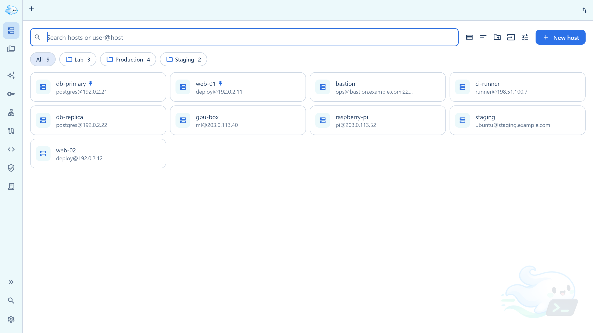
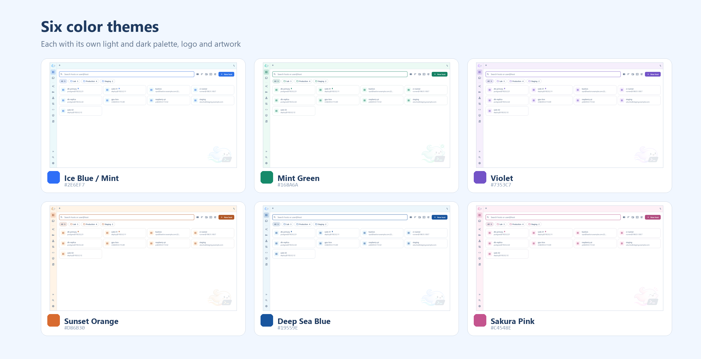
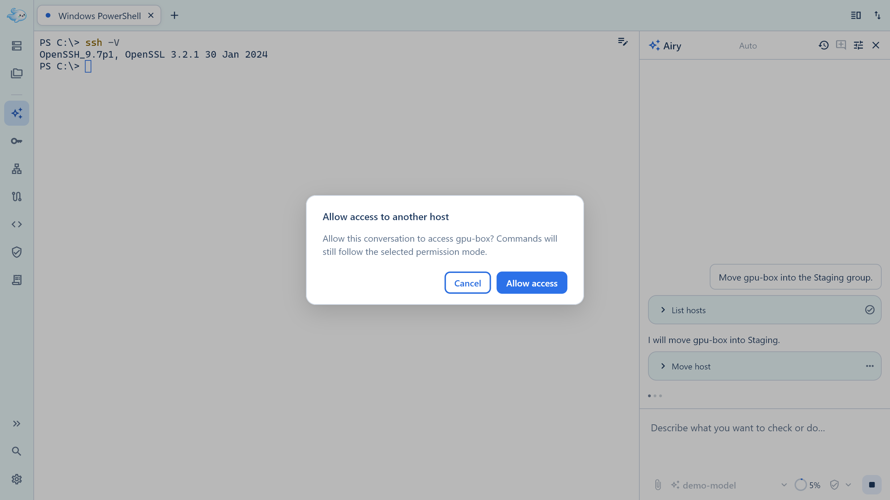
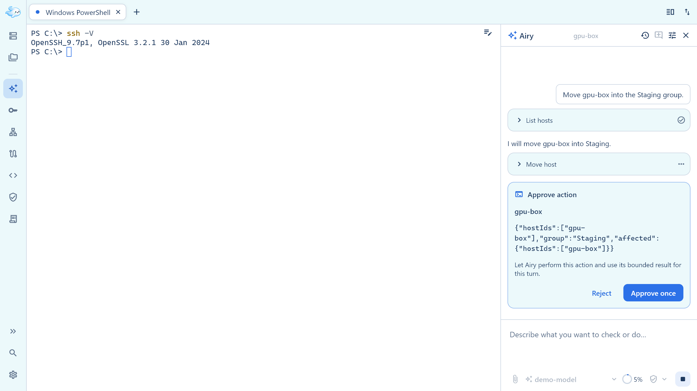
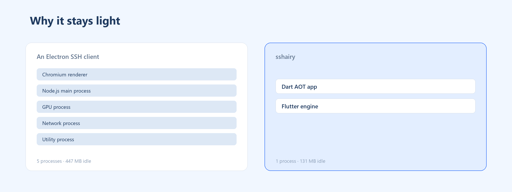
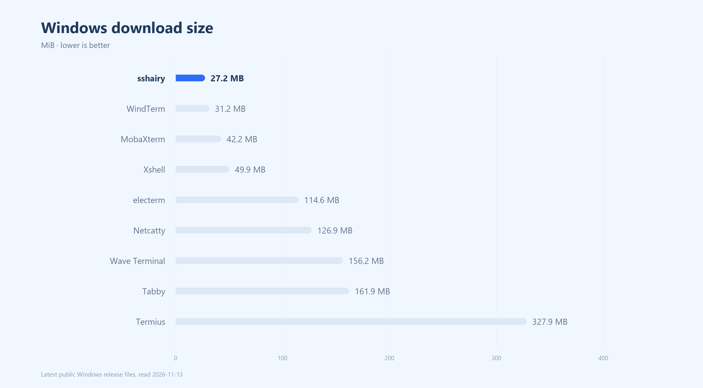

<div align="center">


[](https://flutter.dev)
[](https://dart.dev)

[](README.zh.md)

</div>

<p align="center">
  <picture>
    <source media="(prefers-color-scheme: dark)" srcset="media/hero-dark.png">
    
  </picture>
</p>

**sshairy** is a desktop SSH client written in Dart and drawn by Flutter. It opens in about half a second, idles at 131 MB and ships as a 27 MB portable ZIP. There is no bundled browser and no WebView: the app is compiled ahead of time and runs as a single process.

Airy, the built-in agent, can inspect hosts, read the terminal, run diagnostics, move files and execute commands. It works with a fixed set of 39 typed tools and asks before it acts.

<p align="center">
  <picture>
    <source media="(prefers-color-scheme: dark)" srcset="media/stats-dark.png">
    
  </picture>
</p>

<p align="center"><sub>Measured on Windows 11, Ryzen 7 8845HS, 2026-11-13. Details below.</sub></p>

## Contents

- [Screenshots](#screenshots)
- [Features](#features)
- [Airy](#airy)
- [Performance](#performance)
- [Comparison](#comparison)
- [Getting started](#getting-started)
- [Project status](#project-status)

## Screenshots

<p align="center">
  
</p>

The default Ice Blue / Mint theme on a light surface. Hosts are grouped, tagged, pinned and searchable.

<p align="center">
  <picture>
    <source media="(prefers-color-scheme: dark)" srcset="media/themes-dark.png">
    
  </picture>
</p>

Six color themes, each with its own light and dark palette, logo and artwork: Ice Blue / Mint (the official identity), Mint Green, Violet, Sunset Orange, Deep Sea Blue and Sakura Pink.

## Features

| | |
|---|---|
| **Hosts** | Groups, tags, pins, search, recent connections; password and key auth; Ed25519 key generation |
| **Terminal** | Tabs, splits, search, copy/paste, reconnect, restored layout |
| **Files** | Dual-pane SFTP, queue, conflict handling, external editor |
| **Forwarding** | Local, remote and dynamic forwards with running-forward status |
| **Monitor** | CPU, memory and disk read from `/proc`, nothing installed on the server |
| **Snippets** | Searchable, tagged; insert or run after an explicit confirmation |
| **Completion** | 1,453 bundled shell completion specs |
| **Appearance** | Six themes × light/dark, English / Chinese UI, Skia or Impeller |
| **Security** | Secrets only in the OS secure store; host keys pinned on first use; a changed key blocks the connection |

## Airy

Airy drives the same typed use cases and `CapabilityDispatcher` as the command palette. It cannot invent a capability, and an approval is bound to the exact arguments, target host route and model — if any of them change, the approval is void.

Four permission modes: Observe (read-only, approve reads), Confirm (approve reads and commands, the default), Auto confirm (a second model reviews each action) and Full auto (no prompts). Passwords and private keys never enter the conversation, and only a bounded projection of command output is sent back to the model.

<p align="center">
  
</p>

<p align="center">
  
</p>

The screenshots above use demo hosts, a local PowerShell session and a scripted stand-in for the model. No server is contacted.

## Performance

All three clients were measured on the same machine with an empty profile. Start time is the median of five warm runs from process creation to the first visible window; memory is the unique set size of the whole process tree 15 seconds after launch, with no sessions open.

<p align="center">
  <picture>
    <source media="(prefers-color-scheme: dark)" srcset="media/start-dark.png">
    
  </picture>
</p>

<p align="center">
  <picture>
    <source media="(prefers-color-scheme: dark)" srcset="media/memory-dark.png">
    
  </picture>
</p>

The reason is architectural. An Electron client boots Chromium, Node.js, a GPU process, a network process and utilities; sshairy loads one AOT-compiled Dart binary and the Flutter engine.

<p align="center">
  <picture>
    <source media="(prefers-color-scheme: dark)" srcset="media/architecture-dark.png">
    
  </picture>
</p>

<p align="center">
  <picture>
    <source media="(prefers-color-scheme: dark)" srcset="media/download-dark.png">
    
  </picture>
</p>

Most of the 97 MB unpacked folder is content, not overhead: 1,453 shell completion specs are the largest single piece.

<p align="center">
  <picture>
    <source media="(prefers-color-scheme: dark)" srcset="media/inside-dark.png">
    
  </picture>
</p>

## Comparison

Feature information comes from each project's own documentation, November 2026. Start time and idle memory were measured only for clients installed on the test machine; download sizes come from public release files.

| Client | Built with | Built-in AI | Windows download | Start¹ | Idle RAM¹ | License |
|---|---|---:|---:|---:|---:|---|
| **sshairy** | Dart + Flutter (native) | Agent, 39 tools | **27 MB** | **0.62 s** | **131 MB** | open source, license TBD |
| Netcatty | Electron + React | Agent | 127 MB | 2.60 s | 447 MB | GPL-3.0 |
| Wave Terminal | Electron + Go | Wave AI | 156 MB | — | — | Apache-2.0 |
| Termius | Electron | Command AI, agent beta | 328 MB | — | — | proprietary |
| Tabby | Electron + Angular | no | 162 MB | — | — | MIT |
| electerm | Electron | Assistant with agent mode | 115 MB | — | — | MIT |
| FinalShell | Java, bundled JRE | no | — | 7.55 s | 334 MB | proprietary |
| MobaXterm | native | no | 42 MB | — | — | proprietary (free Home) |
| Xshell | native | no | 50 MB | — | — | proprietary (free Home) |
| WindTerm | C, native | no | 31 MB | — | — | partly open source |

¹ Windows 11, Ryzen 7 8845HS, 2026-11-13. sshairy and Netcatty from their own installs; FinalShell from a data-free copy of its install folder. The other clients were not downloaded or run.

## Getting started

Requires Flutter 3.47.9 / Dart 3.13.7 and, on Windows, Visual Studio's Desktop development with C++ workload.

```sh
flutter pub get
flutter run -d windows
```

Checks and packaging:

```sh
flutter analyze
dart run tool/check_imports.dart
flutter test
```

```powershell
./tool/package_windows.ps1
```

The whole folder is the app — do not copy the exe alone.

To reproduce the figures:

```sh
python tool/readme/measure_startup.py sshairy <empty-profile-dir> "build/windows/x64/runner/Release/sshairy.exe"
python tool/readme/fetch_release_sizes.py wavetermdev/waveterm Eugeny/tabby electerm/electerm
python tool/readme/make_images.py Sshairy-Brand-Asset-Pack media
```

`measure_startup.py` redirects `USERPROFILE`, `APPDATA` and `LOCALAPPDATA` for the child process, so it never reads or writes your real profile. Screenshots are generated by `integration_test/readme_shots_test.dart`; the six-theme board is assembled from those real application screenshots by `make_images.py`.

## Project status

- Developed and tested on Windows 11. macOS and Linux are goals, not verified builds.
- The package is unsigned: no installer, no auto-update; SmartScreen will warn.
- AI is opt-in. Configure an Anthropic Messages or OpenAI-compatible endpoint in Settings.
- The license has not been chosen yet. It will be open source, but do not assume MIT today.
- The idle figures above are after launch with no sessions. Memory under heavy multi-tab load is still being profiled.
- ~1,730 unit and widget tests; no CI yet.

<div align="center">

[English](README.md) · [中文](README.zh.md)

</div>
