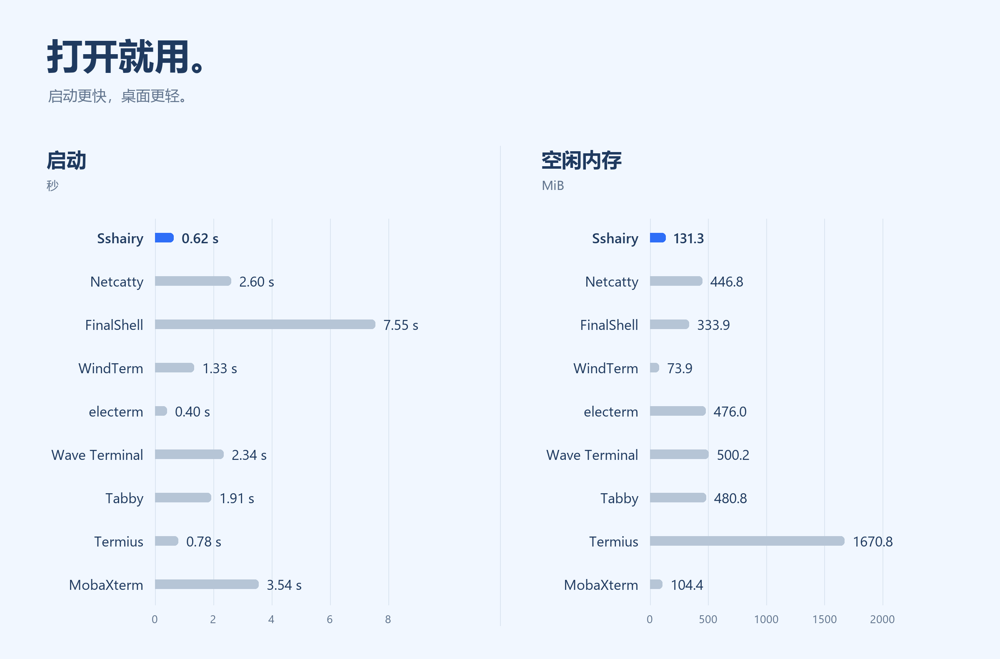

<div align="center">


[](https://flutter.dev)

[](README.md)
[](README.zh.md)


[功能](#功能) · [Airy](#airy) · [主题](#主题) · [性能](#性能) · [构建](#构建)

</div>

**Sshairy** 是一款面向 **Windows、macOS、Linux** 的轻量 SSH 客户端。终端、SFTP、端口转发、服务器监控，收进一个现代、清爽的原生界面，使用 Dart 与 Flutter 构建。

先做好 SSH，再让 AI 帮忙。习惯的终端操作照常，需要时让 Airy 处理任务，或把一句话变成命令。不依赖 Chromium，不套 WebView，轻快地完成日常服务器工作。


## 功能

| | |
|---|---|
| **连接** | 主机分组、标签、置顶、搜索；密码与密钥认证，生成 Ed25519 密钥，支持跳板与代理。 |
| **终端** | 多标签、拖放分屏、本地 Shell、搜索、重连与布局恢复。 |
| **文件** | 双栏 SFTP、传输队列、单文件断点续传、冲突处理与外部编辑器。 |
| **监控** | 通过 SSH 查看 CPU、内存、磁盘与进程，服务器无需安装额外软件。 |
| **工具** | 本地、远程、动态端口转发；命令片段，1,453 个 Shell 补全规格。 |
| **体验** | 主机密钥校验、系统凭据存储、中英界面与自定义快捷键。 |

## Airy

终端旁的 AI 助手，通过 **39 个工具**管理主机、远端文件、命令、会话、布局与设置。接入你选择的 Anthropic 或 OpenAI 兼容模型，决定哪些工作交给它。

- **Agent**：说出任务，让 Airy 分步处理。
- **行内命令**：把自然语言需求变成可编辑的命令。
- **AI 补全**：随输入给出建议，与 Shell 规格和命令历史一起使用。

四档权限适应不同工作方式：**观察、确认、自动确认、完全自动**。默认采用确认模式，目标与操作内容直接展示，由你批准。


## 主题

冰蓝薄荷、薄荷绿、紫罗兰、落日橙、深海蓝、樱花粉。背景、控件、终端和 Airy 素材一起换，每套都有浅色与深色外观。


## 性能

**0.62 秒打开，空闲内存 131 MiB。** 相比 Netcatty，空闲内存低约 **71%**，启动约快 **4 倍**。



<!-- benchmark-table -->

| 客户端 | 启动 | 空闲内存 | 磁盘占用 |
|---|---:|---:|---:|
| **Sshairy** | **0.62 秒** | **131.3 MiB** | **97.4 MiB** |
| Netcatty | 2.60 秒 | 446.8 MiB | 471.8 MiB |
| FinalShell | 7.55 秒 | 333.9 MiB | 189.4 MiB |
| WindTerm | 1.33 秒 | 73.9 MiB | 75.8 MiB |
| electerm | 0.40 秒 | 476.0 MiB | 365.9 MiB |
| Wave Terminal | 2.34 秒 | 500.2 MiB | 616.1 MiB |
| Tabby | 1.91 秒 | 480.8 MiB | 481.4 MiB |
| Termius | 0.78 秒 | 1670.8 MiB | 557.8 MiB |
| MobaXterm | 3.54 秒 | 104.4 MiB | 47.1 MiB |

<!-- /benchmark-table -->

**27 MiB 下载，97.4 MiB 解压体积，单个原生应用进程。** 内置 **1,453 个 Shell 补全规格**。


## 构建

需要 Flutter 3.47.9 / Dart 3.13.7。Windows 还需安装 Visual Studio 的 **C++ 桌面开发**工作负载。

```sh
flutter pub get
flutter run -d windows
```

生成 Windows 便携版：

```powershell
./tool/package_windows.ps1
```

保留完整 Release 文件夹，连同 DLL 和 data 目录一起运行 `sshairy.exe`。

<div align="center">

[English](README.md) · [中文](README.zh.md)

</div>
