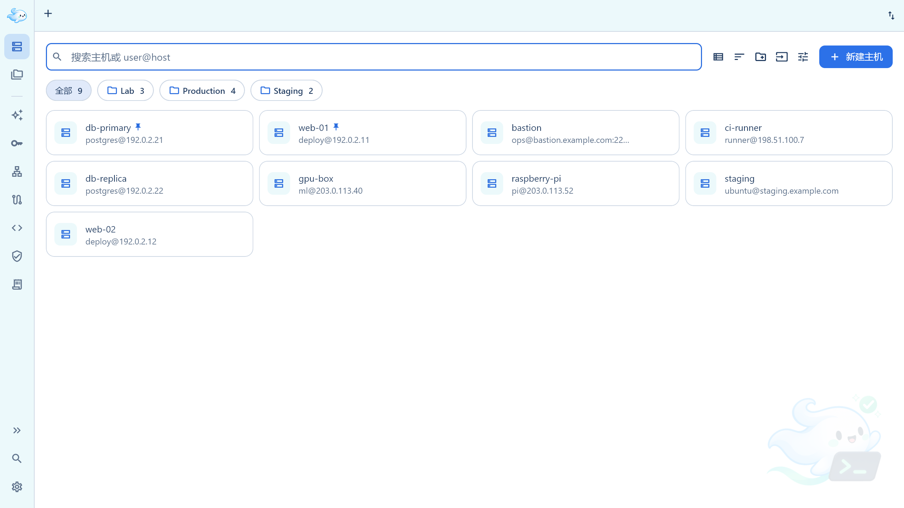
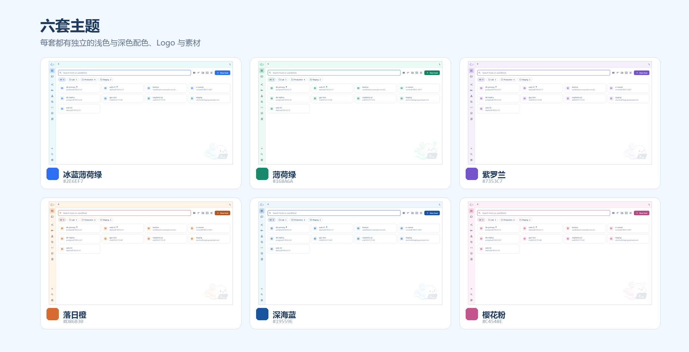
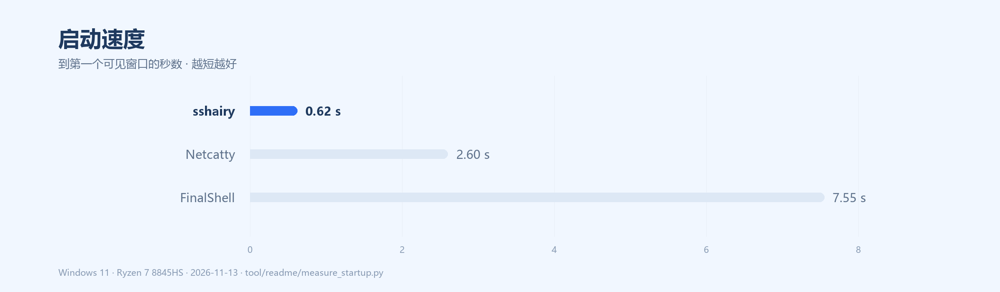
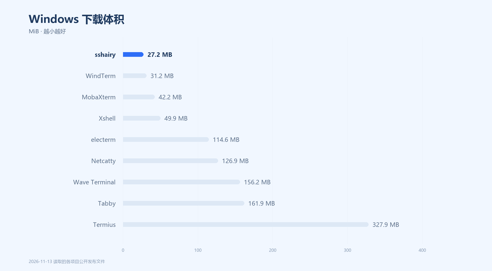
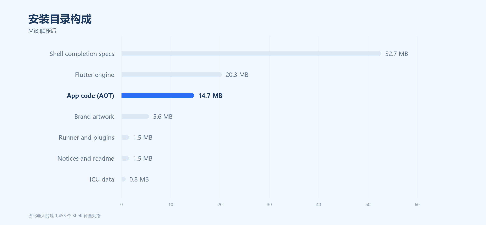

<div align="center">


[](https://flutter.dev)
[](https://dart.dev)

[](README.md)

</div>

<p align="center">
  <picture>
    <source media="(prefers-color-scheme: dark)" srcset="media/zh/hero-dark.png">
    
  </picture>
</p>

**sshairy** 是一个用 Dart 编写、由 Flutter 绘制的桌面 SSH 客户端。约半秒打开窗口,空闲内存 131 MB,便携 ZIP 只有 27 MB。包里没有浏览器,也没有 WebView:应用提前编译,运行时只有一个进程。

内置助手 Airy 可以查看主机、读取终端、跑诊断、移动文件和执行命令。它使用固定的 39 个 typed 工具,动手之前会先征求你的同意。

<p align="center">
  <picture>
    <source media="(prefers-color-scheme: dark)" srcset="media/zh/stats-dark.png">
    
  </picture>
</p>

<p align="center"><sub>2026-11-13 在 Windows 11 / Ryzen 7 8845HS 上实测,方法见下文。</sub></p>

## 目录

- [界面](#界面)
- [功能](#功能)
- [Airy](#airy)
- [性能](#性能)
- [对比](#对比)
- [开始使用](#开始使用)
- [项目现状](#项目现状)

## 界面

<p align="center">
  
</p>

默认的冰蓝薄荷绿主题,浅色界面。主机支持分组、标签、置顶和搜索。

<p align="center">
  <picture>
    <source media="(prefers-color-scheme: dark)" srcset="media/zh/themes-dark.png">
    
  </picture>
</p>

六套主题各有独立的浅色/深色配色、Logo 与素材:冰蓝薄荷绿(官方主配色)、薄荷绿、紫罗兰、落日橙、深海蓝、樱花粉。

## 功能

| | |
|---|---|
| **主机** | 分组、标签、置顶、搜索、最近连接;密码与密钥认证;生成 Ed25519 密钥 |
| **终端** | 多标签、分屏、搜索、复制粘贴、重连、恢复布局 |
| **文件** | 双栏 SFTP、传输队列、冲突处理、外部编辑器 |
| **转发** | 本地、远程、动态转发,可查看运行中的转发 |
| **监控** | 读取 `/proc` 显示 CPU、内存、磁盘,服务器无需安装任何东西 |
| **片段** | 可搜索、带标签;确认后插入或运行 |
| **补全** | 内置 1,453 个 Shell 补全规格 |
| **外观** | 六套主题 × 浅/深,中英界面,Skia / Impeller 可切换 |
| **安全** | 秘密只存系统安全存储;首次使用时固定主机密钥;密钥变化默认阻断连接 |

## Airy

Airy 调用的是命令面板同一套 typed 用例和 `CapabilityDispatcher`,无法凭空创造能力。每次授权都绑定到确切的参数、目标主机路由和模型;任何一项改变,授权立即失效。

四种权限模式:观察(只读工具,读取需批准)、确认(读取和命令都需批准,默认)、自动确认(由第二个模型逐项复核)、完全自动(不弹窗)。密码和私钥不会进入对话,只有一段有界的命令输出投影会发回模型。

<p align="center">
  
</p>

<p align="center">
  
</p>

上面这些截图使用虚构主机、本地 PowerShell 会话和按剧本回复的假模型,不连接任何服务器。

## 性能

三个客户端都在同一台机器上用空配置目录实测。启动时间取 5 次预热启动的中位数,从进程创建到第一个可见窗口;内存是启动 15 秒后、未开任何会话时整个进程树的独占内存。

<p align="center">
  <picture>
    <source media="(prefers-color-scheme: dark)" srcset="media/zh/start-dark.png">
    
  </picture>
</p>

<p align="center">
  <picture>
    <source media="(prefers-color-scheme: dark)" srcset="media/zh/memory-dark.png">
    
  </picture>
</p>

差别来自架构:Electron 客户端要启动 Chromium、Node.js、GPU 进程、网络进程和工具进程;sshairy 只加载一个 AOT 编译的 Dart 程序和 Flutter 引擎。

<p align="center">
  <picture>
    <source media="(prefers-color-scheme: dark)" srcset="media/zh/architecture-dark.png">
    
  </picture>
</p>

<p align="center">
  <picture>
    <source media="(prefers-color-scheme: dark)" srcset="media/zh/download-dark.png">
    
  </picture>
</p>

解压后 97 MB 的目录里,占地方的主要是内容而不是开销:最大一块是 1,453 个 Shell 补全规格。

<p align="center">
  <picture>
    <source media="(prefers-color-scheme: dark)" srcset="media/zh/inside-dark.png">
    
  </picture>
</p>

## 对比

功能信息取自各项目 2026 年 11 月的官方文档。启动时间和空闲内存只测了测试机上已安装的客户端;下载体积取自公开发布的文件。

| 客户端 | 技术栈 | 内置 AI | Windows 下载 | 启动¹ | 空闲内存¹ | 许可证 |
|---|---|---:|---:|---:|---:|---|
| **sshairy** | Dart + Flutter(原生) | Agent,39 个工具 | **27 MB** | **0.62 秒** | **131 MB** | 开源,许可证待定 |
| Netcatty | Electron + React | Agent | 127 MB | 2.60 秒 | 447 MB | GPL-3.0 |
| Wave Terminal | Electron + Go | Wave AI | 156 MB | — | — | Apache-2.0 |
| Termius | Electron | 命令 AI,Agent 内测 | 328 MB | — | — | 专有 |
| Tabby | Electron + Angular | 无 | 162 MB | — | — | MIT |
| electerm | Electron | 助手,含 Agent 模式 | 115 MB | — | — | MIT |
| FinalShell | Java,自带 JRE | 无 | — | 7.55 秒 | 334 MB | 专有 |
| MobaXterm | 原生 | 无 | 42 MB | — | — | 专有(家庭版免费) |
| Xshell | 原生 | 无 | 50 MB | — | — | 专有(家庭版免费) |
| WindTerm | C,原生 | 无 | 31 MB | — | — | 部分开源 |

¹ Windows 11 / Ryzen 7 8845HS,2026-11-13。sshairy 与 Netcatty 用各自安装的版本,FinalShell 用一份不含用户数据的安装副本;其余客户端没有下载或运行。

## 开始使用

需要 Flutter 3.47.9 / Dart 3.13.7;Windows 上还需要 Visual Studio 的 C++ 桌面开发工作负载。

```sh
flutter pub get
flutter run -d windows
```

检查和打包:

```sh
flutter analyze
dart run tool/check_imports.dart
flutter test
```

```powershell
./tool/package_windows.ps1
```

整个文件夹才是程序,不能只复制 exe。

复现数据:

```sh
python tool/readme/measure_startup.py sshairy <空配置目录> "build/windows/x64/runner/Release/sshairy.exe"
python tool/readme/fetch_release_sizes.py wavetermdev/waveterm Eugeny/tabby electerm/electerm
python tool/readme/make_images.py Sshairy-Brand-Asset-Pack media
```

`measure_startup.py` 会为子进程改写 `USERPROFILE`、`APPDATA` 和 `LOCALAPPDATA`,不会读取或写入你真实的用户配置。界面截图由 `integration_test/readme_shots_test.dart` 生成;六主题展示板由 `make_images.py` 用这些真实应用截图拼成。

## 项目现状

- 在 Windows 11 上开发和测试。macOS 与 Linux 是目标,还不是验证过的构建。
- 包未签名:没有安装器、没有自动更新,SmartScreen 会报警。
- AI 默认关闭,需在设置里配置 Anthropic Messages 或 OpenAI 兼容接口。
- 许可证尚未确定。它会是开源的,但今天不要假设就是 MIT。
- 上面的空闲数据是刚启动、未开会话时的值;多标签重负载下的内存仍在分析。
- 约 1,730 个单元与组件测试,还没有 CI。

<div align="center">

[English](README.md) · [中文](README.zh.md)

</div>
