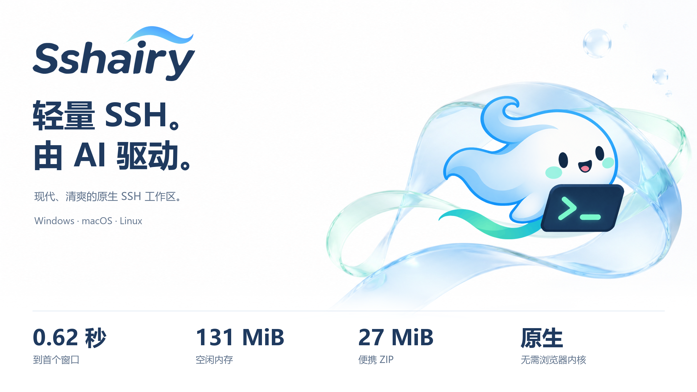
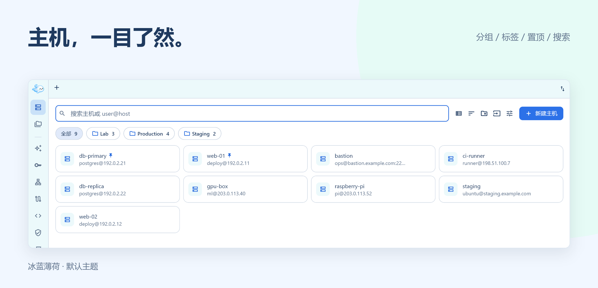
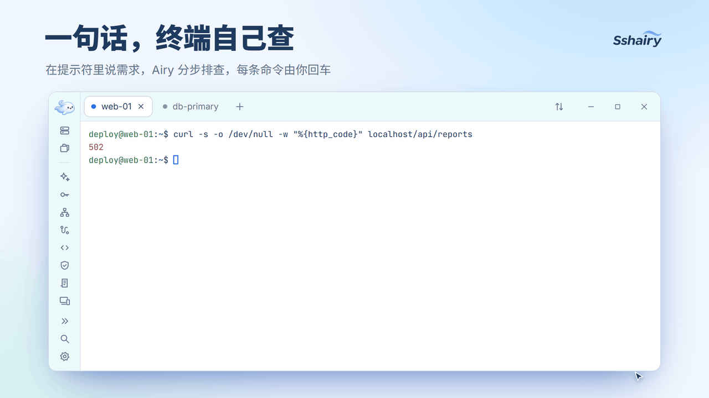
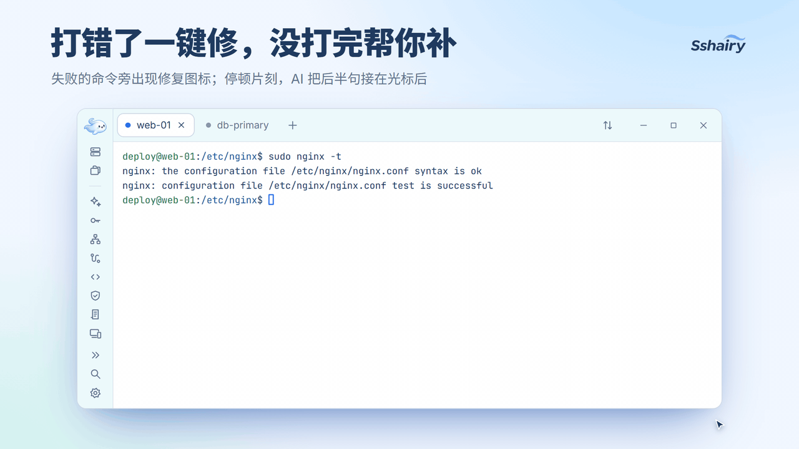
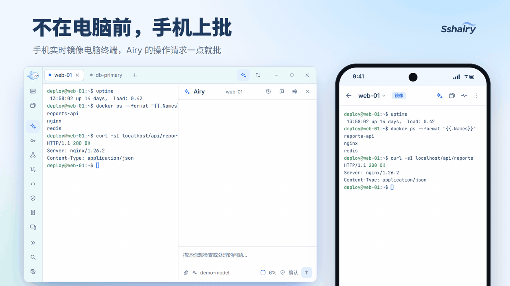
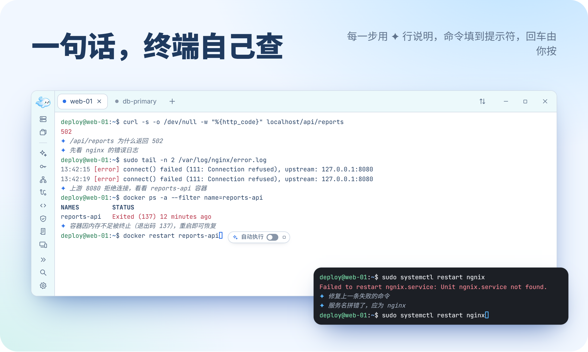
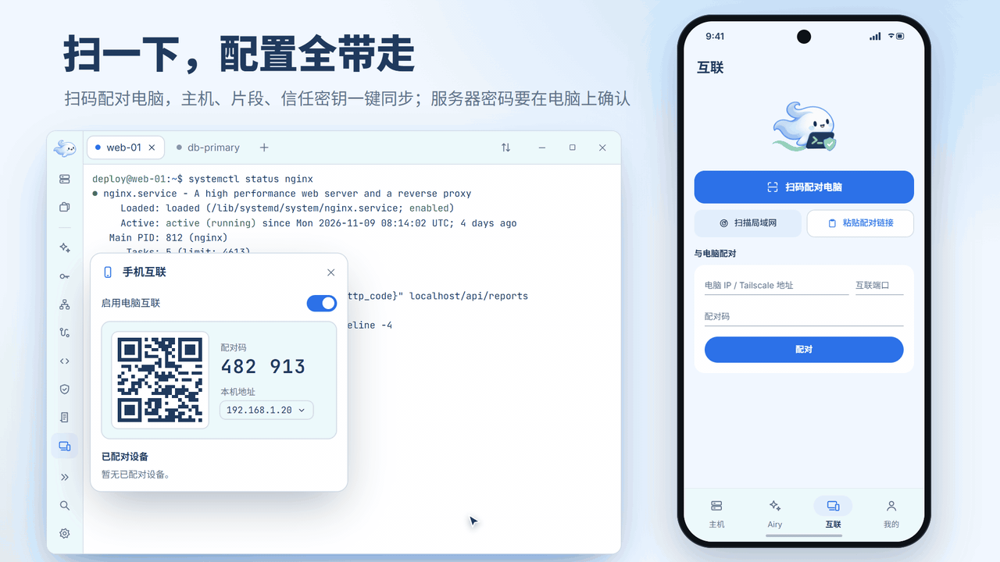
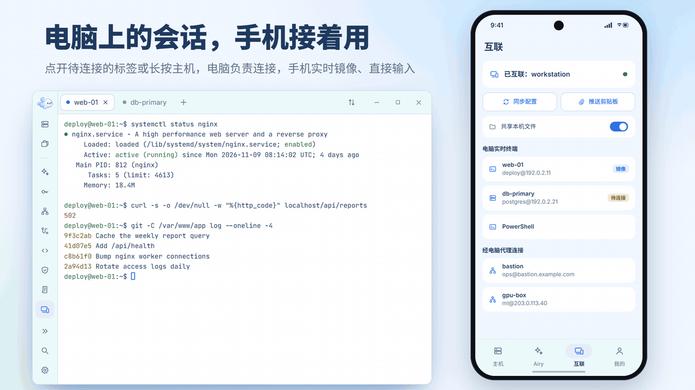
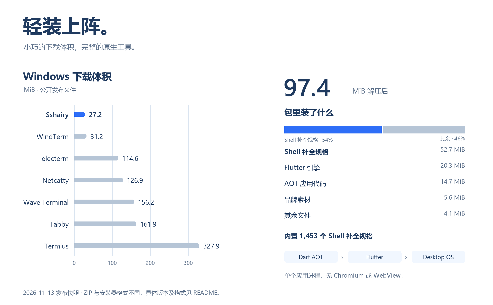

<div align="center">



[官网](https://sshairy.marchen.top/zh/) · [使用场景](#使用场景) · [功能](#功能) · [Airy](#airy) · [手机互联](#手机互联) · [主题](#主题) · [性能](#性能) · [初衷](#初衷) · [获取](#获取) · [English](README.md)


[](https://flutter.dev)

[](https://linux.do)

</div>

**Sshairy** 是一款面向 **Windows、macOS、Linux 和 Android** 的轻量 SSH 客户端，基于 Dart 与 Flutter 构建。电脑端在同一个原生窗口中提供终端、SFTP、端口转发与服务器监控，支持标签、分屏与面板。Android 可用触控终端直连 SSH，也可与电脑互联，镜像电脑上的会话。

- **AI 就在终端里。** 在提示符里直接提需求，Airy 用 ✦ 行分步说明，命令填好等你回车。命令失败时旁边出现修复图标，补全建议以灰字接在光标后。
- **手机随时接手。** 镜像电脑会话、经电脑连接主机、互传文件，Airy 的操作请求在手机上一点就批。
- **一套工具，多个客户端。** Airy 的 42 个工具经你允许后，也可供 Claude Code、Codex 等 MCP 客户端调用。
- **轻到底。** 0.62 秒启动、空闲内存 131 MiB、下载 27 MiB、单个原生进程；不依赖 Chromium，不套 WebView，也不带浏览器运行时。




## 使用场景

### 一句话，终端自己查

在提示符里写下需求，点一下 Airy 图标。Airy 自己翻日志、找到停掉的容器，把每条命令填好；你按回车，或者让剩下的步骤自动执行。



### 打错了一键修，没打完帮你补

服务名拼错导致命令失败，下一行提示符旁出现修复图标。点一下，Airy 说明错在哪并填好正确的命令。输入时停顿片刻，灰字把后半句接在光标后，按 → 接受。



### 不在电脑前，手机上批

离开工位时，手机实时镜像电脑终端。Airy 请求重启容器，手机弹出审批，一点就批。



## 功能


<table>
<tr><td><b>连接</b></td><td>主机分组、标签、置顶、搜索；密码与密钥认证，生成 Ed25519 密钥，支持跳板与代理</td></tr>
<tr><td><b>终端</b></td><td>多标签、拖放分屏、本地 Shell、搜索、重连与布局恢复</td></tr>
<tr><td><b>文件</b></td><td>双栏 SFTP、传输队列、单文件断点续传、冲突处理与外部编辑器</td></tr>
<tr><td><b>监控</b></td><td>通过 SSH 查看 CPU、内存、磁盘与进程，服务器无需安装任何东西</td></tr>
<tr><td><b>工具</b></td><td>本地、远程、动态端口转发；命令片段、1,453 个 Shell 补全规格和 AI 灰字补全</td></tr>
<tr><td><b>体验</b></td><td>现代原生界面，分屏、标签与面板切换顺手；主机密钥校验、系统凭据存储、中英文界面与自定义快捷键</td></tr>
<tr><td><b>手机</b></td><td>Android 预览版：全屏触控终端、命令草稿箱、双栏 SFTP、Airy、后台保活与生物识别应用锁</td></tr>
</table>

## Airy

Airy 在终端旁边，也在终端里，配备 **42 个工具**，可管理主机、远端文件、命令、会话、布局与设置。接入你自己的 Anthropic 或 OpenAI 兼容模型，交给它多少由你决定

- **Agent** 根据描述分步处理任务。
- **行内任务**直接在提示符里提需求，✦ 行说明每一步，下一条命令填好等你回车；也可为当前任务打开自动执行。
- **AI 补全**以灰字接在光标后，按 → 接受；空提示符下还可预测下一条命令。
- **一键修复**在失败的命令旁显示修复图标，点击即给出修复建议。



四档权限覆盖从旁观到放手：**观察、确认、自动确认、全自动**。默认是确认，每个操作都先展示目标和具体内容，由你批准


## MCP / Skill

在 **设置 → MCP / Skill** 中选择审批档位，再开启 Claude Code、Codex、Zcode、DeepSeek Harness 或 Antigravity（`agy` CLI 和 IDE）的对应开关。开关会安装连接配置和 Skill。客户端首次连接时，在 Sshairy 内确认。MCP 与内置 Airy 共用工具目录，包括 SSH 命令与后台任务、文件和传输、终端上下文、工作区、主机、设置及端口转发。

**主机确认**在每次会话中每台主机只问一次。**模型审核**还会逐次审核合规的工具调用。**范围内自动**在所选主机上直接执行，免主机确认和模型审核。访问已有终端和授权本地文件仍须明确确认。同一页可查审计记录，也可撤销客户端接入。

## 手机互联

扫码或在局域网内发现电脑即可配对，互联通道端到端加密。

- **镜像**在手机上实时查看电脑终端。电脑上已打开但未连接的标签显示为「待连接」，点按后由电脑连接。
- **代理**从手机经电脑连接主机，使用电脑上保存的凭据。
- **文件与剪贴板**双向传输已共享的文件和剪贴板文本，也可打开镜像会话对应的文件。
- **审批**在手机上处理 Airy 和 MCP 的审批。
- **同步**把主机、命令片段、主机信任记录和 AI 配置同步到手机；同步已保存的密码需在电脑上确认。






## 主题

冰蓝薄荷、薄荷绿、紫罗兰、落日橙、深海蓝、樱花粉。六套配色贯穿界面、终端与 Airy 形象，浅色和深色都完整适配


## 性能

**0.62 秒启动，空闲内存 131 MiB。** 与 Netcatty 相比，空闲内存低约 **71%**，启动速度约快 **4 倍**


<details>
<summary>完整对比</summary>

<!-- benchmark-table -->

| 客户端 | 启动 | 空闲内存 | 磁盘占用 |
|---|---:|---:|---:|
| **Sshairy** | **0.62 秒** | **131.3 MiB** | **97.4 MiB** |
| Netcatty | 2.60 秒 | 446.8 MiB | 471.8 MiB |
| FinalShell | 7.55 秒 | 333.9 MiB | 189.4 MiB |
| WindTerm | 1.33 秒 | 73.9 MiB | 75.8 MiB |
| electerm | 2.98 秒 | 414.6 MiB | 365.9 MiB |
| Wave Terminal | 2.34 秒 | 500.2 MiB | 616.1 MiB |
| Tabby | 1.91 秒 | 480.8 MiB | 481.4 MiB |
| Termius | 9.74 秒 | 1115.3 MiB | 557.8 MiB |
| MobaXterm | 3.54 秒 | 104.4 MiB | 47.1 MiB |
| Xshell | 3.01 秒 | 35.8 MiB | 102.6 MiB |

<!-- /benchmark-table -->

</details>

**下载体积 27 MiB，解压后 97.4 MiB，单进程原生运行。** 内置 1,453 个 Shell 补全规格



## 初衷

这些年用过不少 SSH 客户端，总觉得差点意思。后来长期用 FinalShell，操作相对顺手，但启动慢、界面不够现代、占用偏高，也缺乏 AI 能力，这些问题都一直困扰着我，相信也有不少人有同感。

最近得闲，于是我下定决心自己做一款占用低、AI 真正融入工作流、界面现代、交互流畅的 SSH 客户端，我把它命名为 Sshairy，是 SSH + Airy 的结合（这个名字也很巧妙的蕴含了“Ai”“hair”等单词（hair 是个意外，但是程序员常常与“hair”有些渊源 Orz...）），意在打造一款轻量、现代、流畅易用的 SSH 客户端。

Sshairy 花了我不少心血，也借鉴了同类软件里做得好的地方。目前主要自用，仍有不少不足；希望能在开源社区的共同维护下，把它做得越来越好~

## 获取

安装包可在 [GitHub Releases](https://github.com/Marchen-orz/sshairy/releases) 下载。版本变化见 [更新日志](CHANGELOG.md)。

| 平台 | 安装包 |
|---|---|
| Windows x64 | `setup.exe` 为当前用户安装，`portable.exe` 免安装直接运行 |
| macOS（Apple 芯片与 Intel） | 通用 DMG 或 ZIP，早期构建 |
| Linux x64 | AppImage 或 `.deb`，早期构建 |
| Android 8.0 及以上 | `arm64-v8a`、`armeabi-v7a` 和 `x86_64` 各有独立的预览 APK |
| iOS | 暂无发行包 |

桌面安装包暂未做分发签名。Windows 首次启动可能出现 SmartScreen 提示（更多信息 → 仍要运行）。macOS 可右键应用选择「打开」，或在「系统设置 → 隐私与安全性」中允许。Android 预览 APK 使用开发签名。

从源码构建需要 Flutter 3.47.9 / Dart 3.13.7。Windows 还需安装 Visual Studio 的 **C++ 桌面开发**工作负载

```sh
flutter pub get
flutter run -d windows
```

生成 Windows 安装包（安装程序需要 [Inno Setup 6](https://jrsoftware.org/isinfo.php)，没有时加 `-SkipInstaller`）：

```powershell
./tool/package_windows.ps1
```

在 macOS 或 Linux 上运行 `./tool/package_unix.sh` 生成 DMG/ZIP 或 AppImage/deb

## 许可证

[MIT](LICENSE)

<div align="center">

[English](README.md) · [中文](README.zh.md)

</div>
