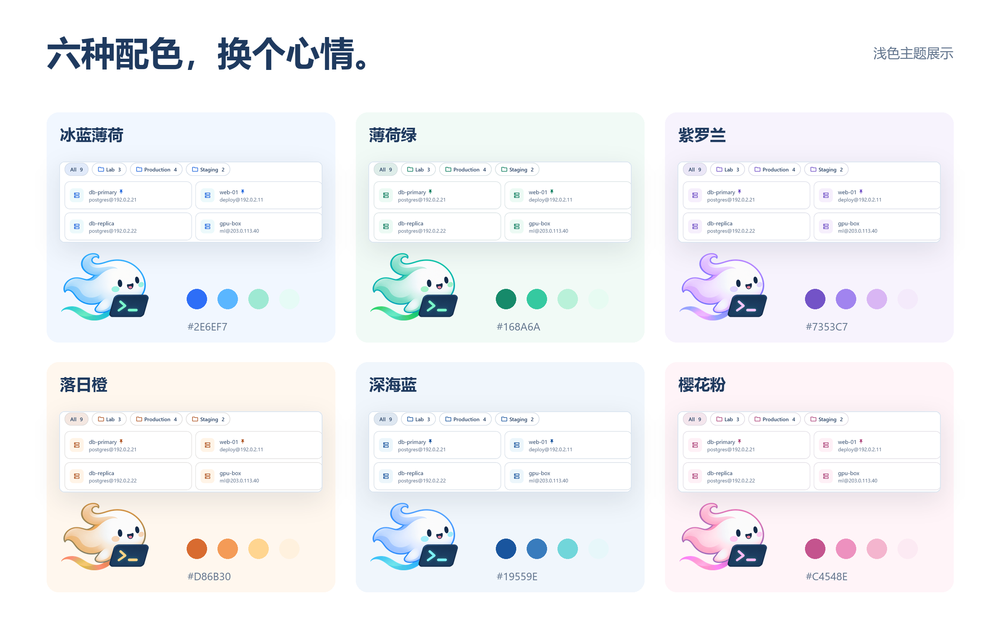

<div align="center">


[](https://flutter.dev)

[](README.md)
[](README.zh.md)


[功能](#功能) · [Airy](#airy) · [主题](#主题) · [性能](#性能) · [构建](#构建)

</div>

**Sshairy** 是一款面向 **Windows、macOS、Linux** 的轻量跨平台 SSH 客户端，使用 Dart 与 Flutter 构建。终端、SFTP、端口转发、服务器监控，都在一个现代、清爽的原生界面里，不依赖 Chromium 或 WebView。

初衷很简单：先做好日常使用的 SSH 客户端，让它启动快、占用少、操作流畅，再让 AI 帮忙。SSH 功能独立可用；需要时，再打开 Airy 助手、行内命令生成和 AI 补全。

在 Windows 测试机上，**0.62 秒**打开窗口，空闲内存 **131 MiB**，下载体积 **27 MiB**。


## 功能

| | |
|---|---|
| **连接** | 主机分组、标签、置顶、搜索；密码与密钥认证，生成 Ed25519 密钥。 |
| **终端** | 多标签、分屏、本地 Shell、搜索、重连与布局恢复。 |
| **文件** | 双栏 SFTP、传输队列、冲突处理、外部编辑器。 |
| **监控** | 通过 SSH 查看 CPU、内存与磁盘，服务器无需安装额外软件。 |
| **工具** | 本地、远程、动态端口转发；命令片段，1,453 个 Shell 补全规格。 |
| **安全** | 认证前校验主机密钥，密钥变化默认阻断；密码和私钥只存系统安全存储。 |

## Airy

在终端旁说出要做的事。Airy 通过 **39 个内置工具**查看主机、处理远端文件、执行命令、辅助排查问题。模型由你选择，支持 Anthropic 与 OpenAI 兼容接口；配置前 AI 默认关闭。

默认的**确认**模式会在操作前展示目标和具体内容，由你批准或拒绝。也可以选只读的**观察**、交给第二个模型审核的**自动确认**，或在选定范围内不再弹出动作审批的**完全自动**。


Sshairy 保存的密码和私钥不会发给模型。工具只返回有界结果；分享前，请留意输出中包含的内容。

<sub>界面图取自运行中的软件，使用虚构主机、本地 PowerShell 和脚本化模型回复；演示未连接远端服务器。</sub>

## 主题

默认冰蓝薄荷，另有五套配色。背景、侧栏、控件和 Airy 素材一起换，每套也都有深色版本；下面展示浅色配色。



## 性能

打开快，空闲占用低。在同一台电脑上，Sshairy 的空闲内存比 Netcatty 低约 **71%**，首个窗口出现约快 **4 倍**。


Dart 提前编译，Flutter 原生绘制。实测 Windows 构建只有**一个应用进程**，解压后 **97.4 MiB**，其中最大的一部分是内置的 Shell 补全库。


<details>
<summary>测量方法、版本与其他客户端</summary>

Windows 11、Ryzen 7 8845HS、24 GB 内存，测量日期 2026-11-13。启动时间为 5 次预热启动的中位数，从进程创建计时到首个可见窗口；内存为启动 15 秒后、未开会话时整个进程树的独占内存。Sshairy 和 Netcatty 使用隔离配置，FinalShell 使用不含用户数据的安装副本。这些是启动与空闲数据，活动会话会增加内存占用。

| 客户端 | 技术栈 | 内置 AI | Windows 下载 | 启动 | 空闲内存 |
|---|---|---|---:|---:|---:|
| **Sshairy 0.1.0** | Dart + Flutter | Airy Agent | **27.2 MiB ZIP** | **0.62 秒** | **131.3 MiB** |
| Netcatty 1.1.90 | Electron + React | Agent | 126.9 MiB 便携 EXE | 2.60 秒 | 446.8 MiB |
| FinalShell¹ | Java + 自带 JRE | 未列出 | — | 7.55 秒 | 333.9 MiB |
| WindTerm 2.7.0 | 原生 / C | 未列出 | 31.2 MiB ZIP | — | — |
| electerm 5.10.0 | Electron | 助手 / Agent 模式 | 114.6 MiB 安装器 | — | — |
| Wave Terminal 0.14.5 | Electron + Go | Wave AI | 156.2 MiB EXE | — | — |
| Tabby 1.0.238 | Electron + Angular | 未列出 | 161.9 MiB 安装器 | — | — |
| Termius | Electron | 命令 AI / Agent 内测 | 327.9 MiB 安装器 | — | — |
| MobaXterm 26.6 | 原生 | 未列出 | 约 42.2 MB 便携包² | — | — |
| Xshell 8 build 0107 | 原生 | 未列出 | 约 49.9 MB 安装器² | — | — |

只运行了 Sshairy、Netcatty 和 FinalShell。其余下载体积来自公开发布信息，ZIP 与安装器的压缩、封装不同，表中已注明格式。“未列出”指查阅的文档未介绍内置 AI，不代表未来版本也没有。

¹ FinalShell 未取得确切版本号；JAR 日期为 2025-04-08，自带 JRE 17.0.7。² 第三方下载目录的 MB 数值，未放入 MiB 图表。

[来源、原始数据与图片制作说明](tool/readme/SOURCES.md)。27.2 MiB ZIP 是测量时的应用包，增加文档或配图会改变压缩包体积。

</details>

## 构建

需要 Flutter 3.47.9 / Dart 3.13.7。Windows 还需安装 Visual Studio 的 **C++ 桌面开发**工作负载。

```sh
flutter pub get
flutter run -d windows
```

生成 Windows 便携版：

```powershell
./tool/package_windows.ps1
```

请保留完整 Release 文件夹，包括 DLL 和 data 目录，不能只复制 exe。

## 项目现状

Sshairy 是一个面向 **Windows、macOS、Linux** 的早期个人项目。目前验证集中在 Windows 11 桌面客户端和 Ubuntu SSH 服务器；macOS、Linux 桌面构建仍待验证。本地终端当前使用 Windows ConPTY，Unix 本地 PTY 尚待适配。Windows 包未签名，暂时没有安装器和自动更新。

项目已确定开源，具体许可证尚待选择。主要供作者自用，不提供兼容性和可用性保障。目前没有 CI，长时间多会话运行的内存占用仍需继续改善。

<div align="center">

[English](README.md) · [中文](README.zh.md)

</div>
