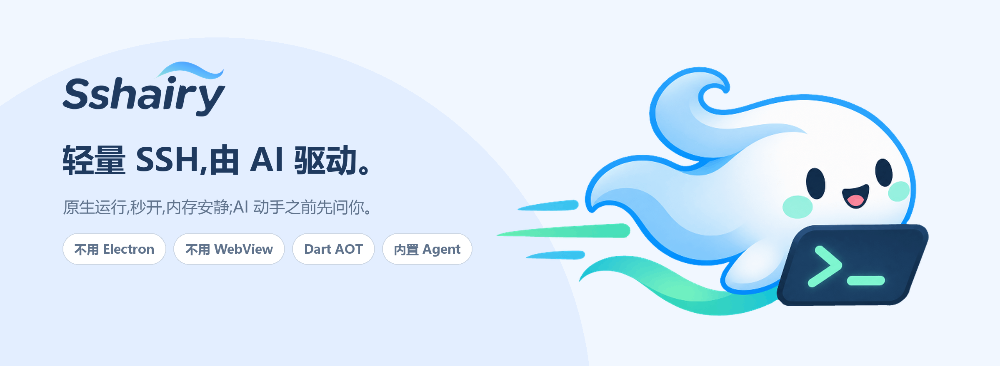
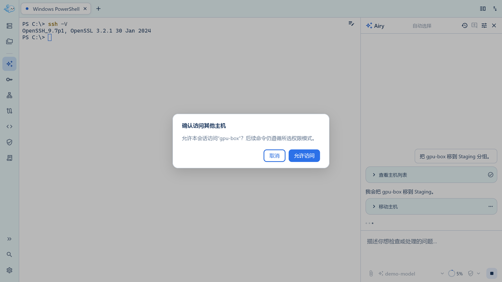
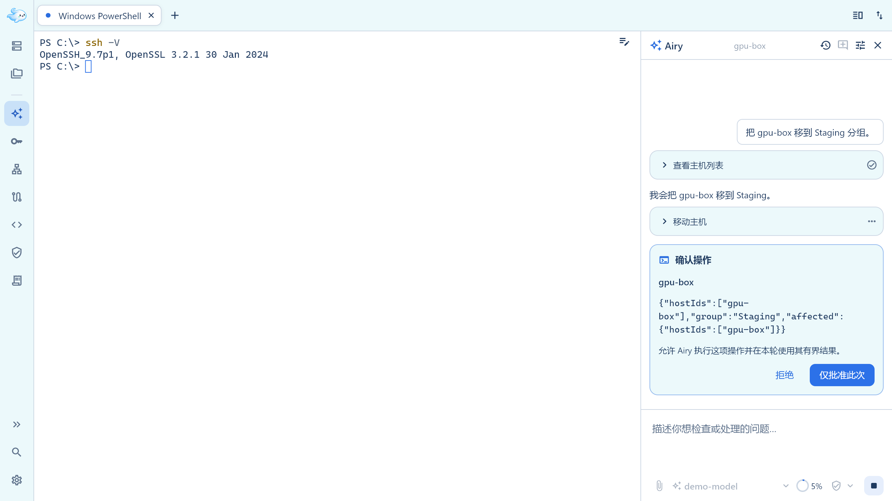
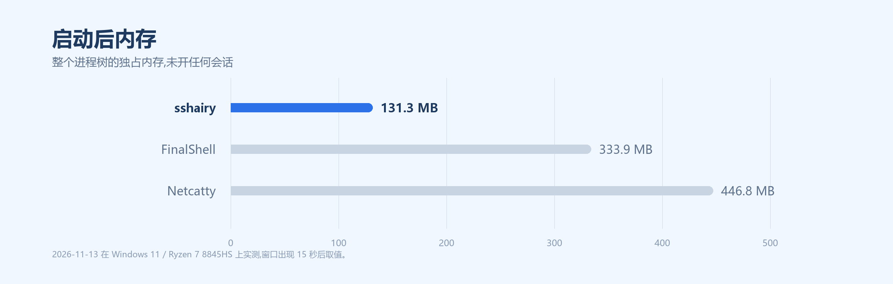
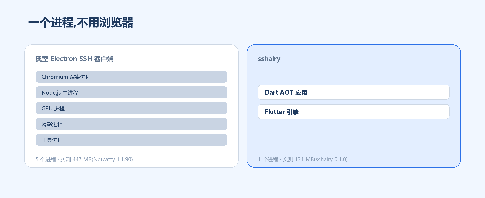

<p align="center">
  <picture>
    <source media="(prefers-color-scheme: dark)" srcset="media/zh/hero-dark.png">
    
  </picture>
</p>

sshairy 是一款把内存和注意力都当稀缺资源的桌面 SSH 客户端。用 Dart 编写、提前编译,由 Flutter 自带的引擎绘制 —— 它按原生应用的方式运行,而不是套着桌面外壳的浏览器。窗口约半秒出现,空闲内存约 131 MB,下载体积 27 MB,整个程序只有一个进程。

它还内置 **Airy**:一个能查看服务器、读取终端、移动文件、执行命令的 AI 助手 —— 动手之前,先把要做的事摆在你面前。

<p align="center">
  <picture>
    <source media="(prefers-color-scheme: dark)" srcset="media/zh/stats-dark.png">
    
  </picture>
</p>

## 为什么还要一个 SSH 客户端

大多数"现代化" SSH 客户端,本质是装进桌面壳里的网页应用:打包 Chromium、Node.js 和一整套渲染器,每次启动先花两秒开一个浏览器,只为了让你往终端里打字。

sshairy 走原生路线:AOT 编译的 Dart 负责业务,Flutter 的 Skia/Impeller 负责像素,安装包里没有任何网页运行时。结果是一个像系统工具一样存在的客户端 —— 手还没离开键盘它就已经在了,任务管理器里也几乎感觉不到它。

<p align="center">
  <picture>
    <source media="(prefers-color-scheme: dark)" srcset="media/zh/hosts-dark.png">
    
  </picture>
</p>

## 里面有什么

- **主机库** —— 分组、标签、置顶、搜索、最近连接;密码与密钥认证,可生成 Ed25519 密钥。
- **终端** —— 多标签、分屏、搜索、复制粘贴、重连、恢复布局;关闭一个标签不会影响其他通道。
- **SFTP** —— 双栏浏览、队列、冲突处理、外部编辑器,可从终端直接上传。
- **端口转发** —— 本地、远程、动态转发,运行中的转发一目了然。
- **服务器监控** —— 直接读 `/proc` 查看 CPU、内存、磁盘,服务器上不用装任何东西。
- **片段** —— 可搜索、带标签;插入或确认后运行,确认随连接失效。
- **命令补全** —— 内置 1,453 个 Shell 补全规格,补全弹窗认识真实的命令、参数和路径。
- **凭据** —— 密码和私钥只存在系统安全存储里。主机密钥首次使用时固定,密钥变化默认阻断连接,除非你主动替换。
- **六套主题,各有浅色与深色** —— 冰蓝薄荷、薄荷绿、紫罗兰、日落橙、深海蓝、樱花粉。中英双语界面,渲染器可在 Skia 与 Impeller 之间切换。

## 一个带刹车的 Agent

Airy 不是外挂在终端上的聊天框。它驱动一册固定的 **39 个 typed 工具**,全部经过命令面板同一个 `CapabilityDispatcher`:列主机、读屏幕、跑诊断、启动命令、传文件、改设置、管理转发,但它无法凭空创造一个不存在的能力。

每次授权都绑定到确切的参数、目标主机路由和当时的模型;任何一项变了,授权立即失效。四种权限模式:

| 模式 | 行为 |
|---|---|
| 观察 | 只用只读工具;读取时询问你 |
| 确认 | 读取和命令都经你批准 —— 默认 |
| 自动确认 | 由第二个模型逐项复核,拿不准时问你 |
| 完全自动 | 读取、执行、共享结果都不再弹窗 |

秘密不会进入对话。命令在可见的终端里执行,只有一段有界的输出投影会被发回模型。

<p align="center">
  <picture>
    <source media="(prefers-color-scheme: dark)" srcset="media/zh/agent-dark.png">
    
  </picture>
</p>

<p align="center">
  <picture>
    <source media="(prefers-color-scheme: dark)" srcset="media/zh/approval-dark.png">
    
  </picture>
</p>

## 快,是因为结构本身

同一台机器、同样空的配置、同样预热的缓存,两个客户端对比。sshairy 不是靠调参赢的,它只是没有加载一个浏览器。

<p align="center">
  <picture>
    <source media="(prefers-color-scheme: dark)" srcset="media/zh/start-dark.png">
    
  </picture>
</p>

<p align="center">
  <picture>
    <source media="(prefers-color-scheme: dark)" srcset="media/zh/memory-dark.png">
    
  </picture>
</p>

<p align="center">
  <picture>
    <source media="(prefers-color-scheme: dark)" srcset="media/zh/architecture-dark.png">
    
  </picture>
</p>

<p align="center">
  <picture>
    <source media="(prefers-color-scheme: dark)" srcset="media/zh/download-dark.png">
    
  </picture>
</p>

安装目录里占地方的并不是代码:97 MB 的文件夹里最大的一块是 1,453 个 Shell 补全规格,整个包压缩后只有 27 MB。

<p align="center">
  <picture>
    <source media="(prefers-color-scheme: dark)" srcset="media/zh/inside-dark.png">
    
  </picture>
</p>

## 和其他客户端比

功能信息取自各项目 2026 年 11 月的官方文档。启动时间和空闲内存只测了测试机上已安装的客户端;下载体积取自公开发布的文件。

| 客户端 | 技术栈 | 内置 AI | Windows 下载 | 启动¹ | 空闲内存¹ | 许可证 |
|---|---|---:|---:|---:|---:|---|
| **sshairy** | Dart + Flutter(原生) | Agent,39 个工具 | **27 MB** | **0.62 秒** | **131 MB** | 开源,许可证待定 |
| Netcatty | Electron + React | Agent | 127 MB | 2.60 秒 | 447 MB | GPL-3.0 |
| Wave Terminal | Electron + Go | Wave AI | 156 MB | — | — | Apache-2.0 |
| Termius | Electron | 命令 AI,Agent 内测 | 328 MB | — | — | 专有 |
| Tabby | Electron + Angular | 无 | 162 MB | — | — | MIT |
| electerm | Electron | 助手,含 Agent 模式 | 115 MB | — | — | MIT |
| FinalShell | Java,自带 JRE | 无 | — | 7.55 秒 | 334 MB | 专有 |
| MobaXterm | 原生 | 无 | 42 MB | — | — | 专有(家庭版免费) |
| Xshell | 原生 | 无 | 50 MB | — | — | 专有(家庭版免费) |
| WindTerm | C,原生 | 无 | 31 MB | — | — | 部分开源 |

¹ 2026-11-13 在 Windows 11 / Ryzen 7 8845HS 上实测:预热启动 5 次取中位数,到第一个可见窗口;随后静置 15 秒,取整个进程树的独占内存,未开任何会话。sshairy 与 Netcatty 用各自安装的版本,FinalShell 用一份不含用户数据的安装副本。只有这三项是实测;其余客户端没有下载或运行。

## 构建与运行

需要 Flutter 3.47.9 / Dart 3.13.7;Windows 上还需要 Visual Studio 的 C++ 桌面开发工作负载。

```sh
flutter pub get
flutter run -d windows
```

检查:

```sh
flutter analyze
dart run tool/check_imports.dart
flutter test
```

打包便携目录、ZIP 和 SHA256:

```powershell
./tool/package_windows.ps1
```

整个文件夹才是程序,不能只复制 exe。

## 现状

sshairy 还很年轻,也如实说明。它主要为作者自己而写,第一周就有几百次提交,不提供任何保证。

- **平台:** 在 Windows 11 上开发和测试。macOS 与 Linux 是目标,还不是验证过的构建。
- **未签名:** 没有安装器、没有自动更新;SmartScreen 会报警。
- **AI 默认关闭:** 在设置里配置 Anthropic Messages 或 OpenAI 兼容接口。没有密钥就没有 AI。
- **许可证:** 尚未确定。它会是开源的,但今天不要假设就是 MIT。
- **长时间会话:** 上面的空闲数据是刚启动、未开会话时的值;多标签重负载下的内存仍在分析。
- **测试:** 约 1,730 个单元与组件测试;还没有 CI。

## 复现这些数字

```sh
python tool/readme/measure_startup.py sshairy <空配置目录> "build/windows/x64/runner/Release/sshairy.exe"
python tool/readme/fetch_release_sizes.py wavetermdev/waveterm Eugeny/tabby electerm/electerm
```

`measure_startup.py` 会为子进程改写 `USERPROFILE`、`APPDATA` 和 `LOCALAPPDATA`,不会读取或写入你真实的用户配置。`fetch_release_sizes.py` 读取 GitHub 最新的公开发布。

截图由 `integration_test/readme_shots_test.dart` 生成:虚构的主机、本地 PowerShell 会话,以及一个按剧本回复的假模型 —— 不连接任何服务器,也没有真实模型参与。

<p align="center"><sub><a href="README.md">English</a> · 中文</sub></p>
