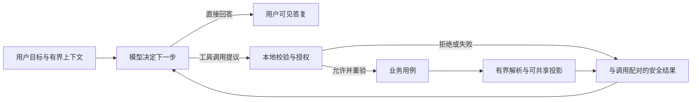
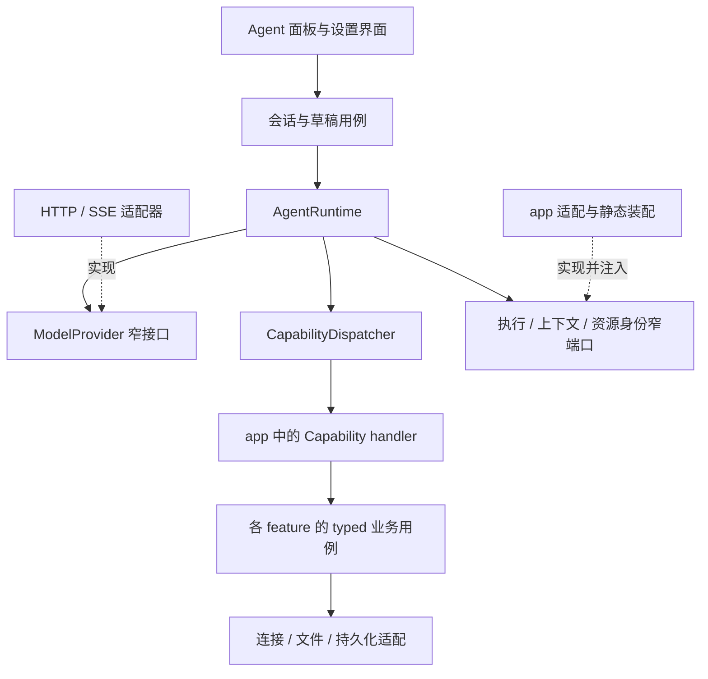
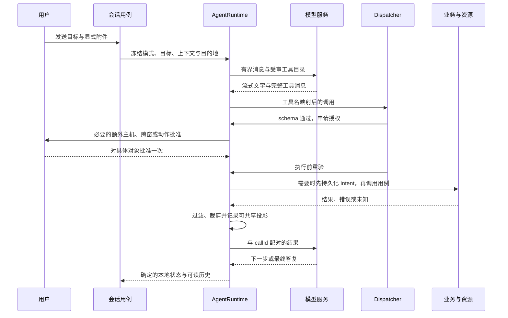

# SSH Agent 设计与实现：以 sshairy 为例

这份导读用 sshairy 的实际代码解释：怎样把一个会生成文字的模型，接进一个能操作服务器的桌面应用；怎样约束它的权限；又怎样在网络、并发、取消和持久化失败时保持诚实。

实现快照：2026-11-13，审核基线 `d66e727`。代码会继续演进，本文讲设计与取舍；正式规则分别以 [DESIGN](DESIGN.md)、[AI](AI.md)、[SECURITY](SECURITY.md)、[CONTRACTS](CONTRACTS.md) 为准，进度与待办以 [ROADMAP](ROADMAP.md) 为准，实际运行结果只认 [TESTING §6](TESTING.md#6-有效验证记录)。文中的服务器任务、JSON 和伪代码都是教学示例，不代表本轮执行过。

建议先读第 1–5 节，建立整体模型；再读第 6–13 节，理解真正容易出错的边界；最后用第 16–18 节准备项目介绍、追问和练习。没有必要先背框架名。

先把几个常见词换成直白的说法：

| 术语 | 在本文中是什么意思 |
|---|---|
| turn | 用户发送一个目标后，AI 连续回答、调用工具，直到结束的这一轮任务 |
| 工具 / Capability | 软件明确提供给模型调用的一项业务操作，例如读取文件或修改字号 |
| typed 用例 | 用明确的 Dart 参数和返回类型表达业务操作，校验与保存集中在这里 |
| scope / binding | 这次允许操作的范围，以及批准具体绑定的主机、对象和版本 |
| lease / channel | 对共享 SSH 连接的一份使用权，以及其中独立的终端/文件/执行通道 |
| TOCTOU | 批准时还是对象 A，真正执行前已经变成 B；中间有等待，就要防这个问题 |

阅读时始终问三件事：模型提出了什么；代码真正允许了什么；执行后有什么证据。

## 1. 从用户问题推导系统结构

用户说：“帮我看看服务器为什么磁盘快满了。”单次模型调用只能根据已有文字回答。要得到可信结论，程序还需要确定服务器、取得授权、采集数据、解析结果、处理失败，并让模型决定是否继续调查。

Agent 的基本循环因此是：



模型负责选择步骤和解释结果；客户端负责权限、参数、执行、状态与数据发送。让模型输出 `approved: true` 不会产生授权，让模型说“已经修复”也不会产生成功事件。

这解释了 Agent 与固定工作流的区别：固定工作流由代码预先规定步骤，Agent 由模型依据反馈选择下一步。一个 Agent 内部仍可使用固定诊断模板，授权和执行流程仍应由确定性代码控制。二者可以组合。

sshairy 的约束决定了当前架构：

| 约束 | 设计选择 | 代价 |
|---|---|---|
| 桌面 SSH 客户端，业务功能先存在 | Agent 复用 typed 用例与连接租约 | 需要维护 AI 与业务之间的参数、身份映射 |
| 会执行真实副作用 | 工具调用先过本地调度器、审批与重验 | 一次调用包含多个异步边界 |
| 自用、轻量、静态功能集 | 单应用、单 Agent、直接实现模型协议 | 协议与运行时需要自己测试 |
| 不给模型本机任意权限 | 窄工具目录、远端文件入口、显式附件 picker | 无法把通用文件浏览能力直接交给模型 |
| 网络不能保证结果可知 | intent、未知终态、不自动重放 | 用户需要核查某些中断操作 |
| 用户一直在使用终端 | 独立 exec channel，不占用当前 PTY | 执行环境与用户交互 shell 不能假定完全相同 |

这里没有引入 MCP、多 Agent、向量数据库或通用工作流引擎。这些技术解决各自的问题，项目目前的主要难点是权限、资源身份和远端副作用，没有必要为了“像 Agent”先引入它们。

## 2. 先给出全局判断

架构方向合理：模型适配、任务循环、能力调度、业务用例、连接资源和界面之间有明确分工；确定性授权、执行前重验、输出投影和未知结果语义已经进入实现。它已经超出“聊天窗口加一个执行命令函数”的阶段。

工具覆盖了 SSH 客户端的主要操作面，当前目录包含 39 个模型工具。它能读终端上下文、采集固定诊断、执行命令、管理有限后台任务，以及操作远端文件、远端传输、主机、会话、布局、普通设置和转发。

完善程度不能由上述两点直接推出。现有实现仍缺少完整的字段/行级证据、变更前后验证流程、可靠的业务终态跟踪、冲突安全撤销、完整审计与真实模型效果评测。具体审核发现和优先级放在 ROADMAP，避免把学习材料变成第二份进度表。

维护上的主要压力集中在 AgentRuntime：它同时协调循环、授权、执行、job 与结果共享。文件长本身不是缺陷，但新增场景会扩大状态组合；适合在具体复杂度增长时，沿既有 owner 与窄端口提取内部职责，并用竞态回归守住边界，不适合现在为套框架重写整个执行层。

审核发现的问题集中在批准之后：任务排队期间连接配置改变、Stop 未传到实际派发点、后台任务没有等待最终状态。修复将冻结授权检查传入业务用例，补齐任务收束，并统一重新生成、协议和编码预算。后文用这些案例解释设计要点；各项实现和实际验证状态统一以 [ROADMAP 的审核记录](ROADMAP.md#agent-全局审核2026-11-13) 与 TESTING §6 为准，不能从设计描述推定所有环境都已验证。

任意 shell 始终以 SSH 账号的实际权限运行。客户端可以约束自己提供的凭据、工具和发送路径，不能靠审批模型、关键词或工具 schema 把远端 shell 变成服务器沙箱。理解这一限制，是评价架构是否合理的前提。

## 3. 代码如何分层



`domain/` 定义纯 Dart DTO、状态和端口；`application/` 推进用例；`adapters/` 处理 HTTP、SSH、文件与第三方库；`presentation/` 呈现用户交互；`app/` 组合各模块。跨 feature 只依赖对方的 `api.dart`。

这种结构可以用端口与适配器、依赖倒置或模块化单体解释，但面试时最好接着说明具体收益：单元测试可以替换模型和 SSH 执行端口；供应商 JSON 不进入业务层；终端无需反向依赖 AI；界面卸载不会顺便销毁传输或远端任务。

### typed 用例、Capability、AgentTool 各解决什么

| 抽象 | 回答的问题 | 示例 |
|---|---|---|
| typed 业务用例 | 业务怎样正确完成 | 设置校验和保存、主机移动、转发启停 |
| Capability | 哪些业务操作可以统一调度 | `settings.patch`、`session.open` |
| AgentTool | 哪些 Capability 可以暴露给模型，以及怎样描述 | `settings_patch`、`session_open` |
| Dispatcher | 此次调用是否合法、是否被授权、是否仍有效 | schema → authorize → revalidate → invoke |

已经有 Capability，不代表可以自动向模型开放。AgentTool 是经过审查的映射目录，带模型工具名、Capability ID、参数映射和 effect 信息；模型不能通过猜测 Capability 名字绕过目录。

普通 UI 可以直接调用 typed façade。焦点、菜单开合、草稿编辑、终端按键属于交互状态，无须都包装成 JSON。模型需要控制的业务动作才登记能力。

这也避免了两套实现：UI 和 Agent 最终复用同一业务保存队列、冲突检查与资源管理规则。若在 Agent handler 里另写一遍持久化，迟早会出现“界面改得对，AI 改得错”。

## 4. 一次 turn 是怎样运行的

这里的 turn 指用户发送一次目标，到 Agent 得到最终答复、失败、取消或结果未知为止的一轮任务。一个 turn 可以包含多次模型请求和多个工具调用。



这是概念时序，不表示每个工具都拨号、写 intent 或弹同样的卡片。例如列出主机不应连接服务器，读取已有终端历史不应重新执行命令；任意 shell 和远端写入则需要更强的生命周期与持久化约束。

教学伪代码：

```text
captureTurnContext()
while turnIsCurrent and budgetsRemain:
    response = await receiveCompleteModelMessage()
    if response.hasNoCalls:
        finishAnswer()
        break
    for call in response.calls:
        tool = resolveReviewedTool(call.name)
        result = await dispatchWithAuthority(tool, call.arguments)
        appendPairedResult(call.id, result)
```

真正的难点隐藏在 `receiveCompleteModelMessage`、`dispatchWithAuthority` 和 `turnIsCurrent` 中：协议是否完整、审批是否属于此 turn、资源是否换过、是否已取消、结果能否发送、写入是否已经发生，都必须在这些位置处理。

有三条容易混淆的成功标准：

- HTTP 正常结束，只证明拿到了完整模型响应。
- 工具成功或退出码为 0，只证明该次操作报告了相应结果。
- 用户的问题已经解决，需要业务验证；例如清理命令退出 0 之后，还要重新测量磁盘。

## 5. 39 个工具怎样组成能力面

名称以 [agent_tool.dart](../lib/features/ai/domain/agent_tool.dart) 为唯一目录，下表解释用途。参数必须以实际 schema 为准，不能把示意参数复制成协议保证。

| 工具组 | 模型工具 | 已有能力与关键边界 |
|---|---|---|
| 发现与上下文，5 个 | `host_list`、`terminal_list`、`terminal_history_read`、`terminal_screen_read`、`output_read` | 主机安全别名快照；终端分页目录；有界历史与可见屏幕；已共享投影的重读 |
| 诊断与执行，6 个 | `diagnostics_collect`、`command_execute`、`job_start`、`job_read`、`job_status`、`job_stop` | 固定模板、独立 exec、随 turn 管理的有限后台任务 |
| 远端文件，7 个 | `files_list`、`files_stat`、`files_read`、`files_write`、`files_mkdir`、`files_rename`、`files_delete` | 显式远端 HostId，小文本分页与摘要覆盖；不提供本机文件路径入口 |
| 远端传输，3 个 | `transfer_list`、`transfer_enqueue`、`transfer_cancel` | 已授权远端之间复制，任务 ID、状态与进度；本机端点不对 Agent 开放 |
| 主机管理，4 个 | `hosts_create`、`hosts_update`、`hosts_move`、`hosts_delete` | 主机元信息管理与组路径移动，返回去敏 DTO；新建主机不自动进入本 turn 连接范围 |
| 会话与布局，7 个 | `session_open`、`session_close`、`session_reconnect`、`workspace_focus`、`workspace_split`、`workspace_rename`、`workspace_close_tabs` | 复用真实会话/布局用例；分屏与重连会创建资源，关闭可能结束会话 |
| 设置与转发，7 个 | `settings_get`、`settings_patch`、`forwards_list`、`forwards_save`、`forwards_delete`、`forwards_start`、`forwards_stop` | 普通设置白名单、修订校验、转发规则与运行实例绑定 |

工具数是能力目录的统计，不代表每种权限模式都会暴露全部工具，也不代表任意组合已完成实测。

### 为什么还要固定诊断模板

`diagnostics_collect` 有五类常量模板：系统与内存、磁盘容量、进程资源、监听端口、systemd 服务状态。模板没有任意 shell 参数，结果走字段白名单解析。

这提供了比“让模型自己写 `ps`”更窄、更可预测的读取面：进程摘要不取完整参数和环境，端口模板不顺便提供连接或进程归属，服务模板不直接发送完整日志。缺少命令或解析失败时返回缺口，不回退为原始全文。

固定模板也有测量限制。例如 `ps` 的 CPU 百分比是进程生存期平均值，不是即时采样；系统模板尚不能据此声称测出了两次采样的 CPU 利用率。工具说明和答复必须尊重采集语义。

### 齐全应怎样判断

评估工具集，要看能否走通“发现目标 → 取得标识 → 授权 → 操作 → 观察终态 → 验证效果”。提供一个 `start` 函数，却没有发现资源或观察结果的路径，仍可能无法完成任务。

现有工具已经覆盖主要操作面，但 `session_open` 的 accepted 不等于 connected；后台 job 的本 turn 生命周期不等于可跨重启任务系统；聊天附件不等于本机文件传输授权；模型写计划文字不等于已经实现 `plan.update`。这些区别比继续增加工具数量更有价值。

精确操作分屏说明了资源粒度的重要性：终端目录给出 paneId，focus、close、reconnect 就应接受相同粒度的目标，split 也应返回新 paneId。修复补齐了这条标识链，显式 pane 不存在或不属于指定标签时拒绝，不能回退到当前焦点。这样才能表达“保留左边，只重连右边”，而不是只知道右边的 ID 却无法操作。

设置工具还体现了接口可用性：只返回 `accent=blue`，模型无法知道界面叫“冰蓝薄荷”；只返回 `fontSize`，也容易混淆终端字号与界面字号。当前 `settings_get` 返回稳定 ID、值、revision 和与界面共用的本地化 definitions，模型用 ID 调用、用可见名称解释；修改时再携带 `expectedRevision`。面向模型的接口也需要和用户的概念对齐，不能只追求 JSON 可解析。

## 6. 审批要分成几层理解

“用户允许 AI 工作”不能转化成一个永久布尔值。至少要回答：允许访问哪台主机、读取哪个窗口、执行什么动作、把哪份结果发送给哪个模型，以及批准之后对象是否仍是原来的对象。

### 四种模式只管理其中一层

| 边界 | 观察 observe | 确认 confirm | 自动确认 review | 全自动 auto |
|---|---|---|---|---|
| 任意 shell / job 启动 | 确定性拒绝 | 逐项人工 | 独立审批模型，必要时回人工 | 范围内免逐项批准 |
| 固定诊断 | 人工 | 人工 | 审批模型或人工 | 范围内免逐项批准 |
| 其他已开放业务动作 | 只允许目录中的查询，拒绝变更 | 按动作审批 | 按动作审核及其强制人工规则 | 仍受工具硬性规则约束 |
| 首次访问额外主机 | 人工许可 | 人工许可 | 人工许可 | 人工许可 |
| 读取其他终端窗口 | 人工许可 | 人工许可 | 人工许可 | 人工许可 |
| 每次可见屏幕读取 | 人工许可 | 人工许可 | 人工许可 | 人工许可 |
| schema、身份重验、HostTrust、取消、不可委派权限 | 始终检查 | 始终检查 | 始终检查 | 始终检查 |

这是设计要求与主要授权门的矩阵，不是“所有分支已正确实现”的证明。文件查询曾只按工具、主机和路径缓存批准，悄悄扩大到其他页；修复后每次完整参数分别审批。若未来要一次批准整份文件，就必须在卡片明确范围，并绑定内容基线。人工命令卡也补上了实际规范化超时，用户能够区分同命令运行 1 秒还是 300 秒。内部绑定了某字段，不等于用户已经看见并批准该字段。

模式在用户发送时冻结，运行中不能改变，历史不会恢复旧模式。普通设置与布局也不能一概视为低风险：修改安全策略不开放；分屏可能创建 shell，关闭标签可能结束多个会话。

额外主机许可和动作批准是两件事。用户批准访问服务器 B，并未批准在 B 执行任意命令；用户批准在服务器 A 执行某命令，也没有授权换成 B。额外主机许可可在同会话、绑定未失效时复用，具体动作批准仍有自己的范围。

### 为什么不再审批一次结果发送

当前约定是：批准具体动作，同时允许当前主模型使用该操作的有界结果。这使一次工具循环保持可用，避免“批准命令—等运行—再批准发送”造成大量重复交互。

代价是审批时必须讲清动作会返回数据，结果投影必须受限。原始输出与共享投影仍分开；后续 `output_read` 只能重读已有共享投影，不会因为有句柄就获得原始缓冲。

### 独立审批模型扮演什么角色

review 模式使用独立、无工具的请求，只接受严格的 `allow / deny / ask`。它看到用户目标与具体动作元信息，不提前看到工具输出，也不能编辑参数、批准另一台主机或改变策略。异常、超时、不确定或预算不足时回人工。

这是用户选择委派的一种判断方式。安全边界仍在确定性代码中：若 schema、主机范围、资源身份或权限不符合，审批模型说 allow 也不能执行。它不是远端 shell 的语义证明器。

## 7. 资源身份与 TOCTOU：批准的是哪一个对象

TOCTOU 指检查时和使用时之间，条件可能改变。异步审批让这个问题变得日常：用户看着批准卡时，标签可以关闭、主机配置可以修改、转发可以重启，另一个异步保存也可能先提交。

假设批准卡上写着“关闭当前窗口”。等待期间用户切换了焦点。如果执行时重新解释“当前”，就可能关掉另一窗口。正确方式是在批准前解析实际对象，把批准绑定到它，执行前再比较。

| 标识/绑定 | 含义 | 不能替代什么 |
|---|---|---|
| HostId | 主机库中的逻辑对象 | 不证明地址、路由或凭据没变 |
| SessionId、tabId、paneId | 终端与布局中的对象 | 不证明 shell 仍为同一代 |
| transport / route / config binding | 实际连接与有效配置 | 不替代用户动作批准 |
| generation / revision | 连接代次、历史或库的版本 | 不替代对象归属 |
| owner / turn token | 异步工作属于谁、哪一轮 | 不证明远端副作用是否发生 |
| 运行实例身份 | 某次转发或传输 attempt | 不等于同名保存规则 |

[app/ai_resources.dart](../lib/app/ai_resources.dart) 在组合层解析资源，AI 领域只获得窄快照。对象身份和非秘密完整参数用于本地审批与重验，不需要把连接对象交给模型。

重验不应只做一次：schema 之后、审批之后、等待连接之后、intent 落盘之后、进入真实 handler 前，都可能出现新的异步间隙。越靠近副作用的检查，越能缩小“已经验证但尚未使用”的窗口。

审核时文件工具只在 handler 前检查路由，连接池等待期间却可能按新配置重试；传输队列也只保留 HostId 和路径。修复让 RequestContext 携带冻结的配置和主机路由检查，文件池在取得资源后重验，句柄再检查自己的租约是否仍有效，复合写入在新请求派发前检查。传输队列接收同一授权约束，不跟随 HostId 自动转到新服务器。这个检查不能依赖原调用的临时 prepared 表，因为任务交给应用队列后可能仍在等待。

本地修订冲突也一样。仅在 UI 点击时比较 revision 不够，typed 保存用例必须在串行提交队列里再比较，才能防止两个等待者都拿旧快照覆盖新值。设置 patch 要求读取所得 `expectedRevision`，冲突后应重新读取并重新决定，不能静默覆盖。

### 原子性有边界

队列内的本地修订检查、同一目录的原子替换、远端跨协议条件写入，是不同保证。SFTP 没有通用的内容 compare-and-swap：即使写前两次比对摘要，最后一次检查与 rename 之间仍有竞态。

好的设计会尽量缩小窗口并明确限制；不会把“使用了 SHA256”和“使用了 rename”组合成不存在的全局事务。

## 8. 协议完整性：为什么不能收到半个 JSON 就执行

模型服务返回的是字节流。它至少经过这些边界：

```text
网络 chunk → 增量 UTF-8 → SSE event → 协议内容块 → 完整 assistant message → 工具调用
```

chunk 可以从汉字中间切开；SSE 的一个事件可以跨多次读取；工具参数可以分多段返回；最后一段参数收到之后，消息仍可能因为长度截断或服务错误而不完整。

因此，文字可以先展示，工具必须等完整、合法的消息及正常结束语义后再执行。EOF 不等于成功，参数能 `jsonDecode` 也不等于整条消息已经合法完成。

| 协议 | 调用与结果的关系 |
|---|---|
| Anthropic Messages | assistant 的 `tool_use` 内容块带 id，后续 `tool_result.tool_use_id` 必须对应；多个结果按协议成组返回 |
| OpenAI-compatible Chat Completions | 流式 `tool_calls` 按 index 聚合，后续 `role=tool` 的 `tool_call_id` 对应原调用 |

sshairy 的 [ModelProvider](../lib/features/ai/domain/model.dart) 把供应商响应归一成事件和完整消息。runtime 不应该知道 `choices[0].delta` 或 Anthropic 的内容块 JSON；供应商适配器也不应该负责批准和执行工具。

两个项目中实际遇到过的问题说明了为什么要测试完整链路：工具目录增长到 39 项，但请求编码器仍限制 32 项，替身模型测试能过，真实 HTTP 编码却直接失败；设置 patch 曾带上不受本地 schema 方言支持的隐藏字段定义，导致每次调用在审批前失败。这类 `invalidSchema` 是应用定义错误，不应让模型无限修改参数重试。工具目录、schema 校验器、编码器与真实请求必须一起验证。

拒绝、参数错误、未知工具和执行失败也需要与原 callId 配对的结果，不能直接从消息列表删掉调用。下一次请求、上下文整理和历史投影都必须尊重工具组边界。

还有一种边界来自字段本身的语义。名字里带 delta，不代表一律追加字符串：Anthropic 的文字是追加，签名更新却是替换。旧代码把两次签名 A、B 拼成 AB，可能使工具续聊失败；修复按官方 SDK 的语义只保留 B，并用解析到再次编码的回归守住这一点。协议适配不能只看 JSON 形状，还要理解每个字段怎样更新。

callId 仅用来协议配对。它不是授权令牌，也不是服务端幂等键。不同模型请求里出现相同字符串，不代表可以复用以前的批准或执行结果。

## 9. 状态机、取消和所有权

[agent.dart](../lib/features/ai/domain/agent.dart) 定义了 preparing、streaming、awaitingApproval、executing、completed、stopping、cancelled、failed、outcomeUnknown 等阶段。界面显示这些本地状态，而不是从模型回复中推测状态。

三个容易混为一谈的生命周期：

| 对象 | 寿命 | 结束时意味着什么 |
|---|---|---|
| 会话 conversation | 多个 turn，可有本地历史 | 删除历史，不等于回滚服务器 |
| turn | 一次用户目标及其工具循环 | 停止继续调度，收束自有工作 |
| 模型请求 / exec channel / job | turn 内的具体活动 | 取消或释放各自资源，不应关闭共享 transport |

异步结果回来时，还需要判断 owner、turn token、配置、目标与 generation 是否仍有效。取消 HTTP 只是节省资源；拒绝迟到结果才保证旧任务不会覆盖新界面、批准新动作或把旧输出发送给新模型。

### Stop 到底承诺什么

Stop 停止新调度、撤销未决审批，并传播到实际资源取得和新请求派发处。转发在启动完成前继承请求取消，成功监听后由 Forwards 持有；原 turn 随后结束不能关闭已交接的持久隧道。SFTP rename 在等待目标 stat 后再次检查，避免 Stop 之后才发出新的重命名。传输接受后由 TransferManager 持有，自然结束 turn 不取消，但明确取消、期限和路由失效仍有效。关闭 Agent 面板只是隐藏视图，不等于 Stop。

关闭 SSH channel 无法普遍保证远端所有子进程都终止。例如命令已经自行脱离、写入已经提交、服务器在断线后继续运行。此时不能把本地 cancelled 解释为“没有副作用”，更不能解释为“已经撤销”。

后台 job 同样有明确范围：活动工具和 job 合计最多三个，同主机任意 shell 与副作用互斥，查询和 Stop 有独立通路。结束 turn 时先取消 job，再等待退出及终态落盘，然后释放目标、结束 busy 并保存历史。jobId 与原执行卡关联，退出码、过滤后的有界输出和未知结果进入同一记录；下一 turn 不会抹掉历史里的最终状态。

这里要分清“启动调用成功”和“后台任务完成”。前者可以立刻返回 jobId；后者需要可查的最终记录、所有权和收束机制。它不是跨重启调度平台，也不是用户长期 tmux 服务的管理入口。

### 资源为什么要有唯一 owner

ConnectionManager 管共享 transport；终端、SFTP、exec、转发各持有自己的 channel 或 lease。某个 AI 请求结束，只能释放自己的那份使用权。若模型消费者调用共享 provider 的 close，或取消自己时关闭共享 SSH transport，就会破坏其他入口或用户终端。

应用退出也需要显式协调。可以从 [shutdown.dart](../lib/app/shutdown.dart) 看到：先处理活动任务与保存，再收束会话和连接；失败交还用户选择，而不是靠 Widget dispose 猜测所有事情已经完成。

## 10. intent、未知结果与幂等

考虑这个时序：

```text
客户端提交“写文件” → 服务器完成写入 → 网络断开 → 客户端未收到结果
```

失败发生在观察结果的路径，写入可能已经成功。此时自动重试可能重复创建、覆盖或删除。

当前 operation journal 的重要作用是先记录 mutation intent，再发出需要保护的副作用，并在之后记录完成、失败或 outcomeUnknown。若 intent 落盘失败，就不进入执行。重启发现未决 intent，只能提示未知，不自动重放。

| 状态 | 可以说什么 | 不可以推断什么 |
|---|---|---|
| intent | 客户端已记录准备执行 | 服务器已经执行 |
| completed | 这次操作按其契约完成 | 用户业务问题一定解决 |
| failed | 确定收到了相应失败 | 所有失败都保证无副作用 |
| outcomeUnknown | 无法确定是否发生或是否完成 | 可以放心再执行一次 |

不要把 journal 说成通用幂等引擎。当前记录的是 operation 元信息，不是所有工具的输入摘要、结果缓存与服务端去重记录；有 OperationId 不会让 SSH 获得 exactly-once。

如果要扩展可靠重试，应先分类：纯读取可以重新采集；设置类可用 expectedRevision；创建类可设计业务幂等键；任意 shell 发出后没有通用安全重放方式。外部系统没有去重/事务支持时，客户端只能提供保守语义和核查入口。

客户端自己的上下文也可能被成功动作撤销。例如关闭本 turn 已共享的聚焦 pane，或删除相关主机，副作用可能已经完成，随后却因上下文失效而终止本轮并报告 `scopeChanged`。此前软件内测试会另查实际状态，不能只凭最后一个错误码推断“什么都没发生”，也不能为了继续流程而放松身份校验。

撤回消息和重新生成也遵循这一点：撤回调整对话上下文、恢复草稿；重新生成使用允许续传的普通历史作无工具回答。二者都不能重新执行以前的命令，也不撤销已经发生的操作。

重新生成曾只恢复内存里的旧回答，磁盘却可能保留失败快照；修复在回滚后等待恢复内容保存。重答也改用最后真实用户问题作为不可裁剪的 goal，显式保留附件，其他历史仍可有界整理；保留已共享执行结果供解释，但不重放工具。设计上应先固定必要问题，再裁其他材料；失败回滚则要同时恢复界面和持久化。

## 11. 上下文、输出和历史不能混成一份状态

Agent 需要记忆，但不同记忆的权限和用途不同。

| 数据 | 用途 | 关键限制 |
|---|---|---|
| 活动协议消息 | 继续当前模型工具循环 | 保持 call/result 与供应商续接语义 |
| 原始工具缓冲 | 本地有限观察与处理 | 不因为存在就可自动发送 |
| 可共享投影 | 当前模型获准使用的数据 | 有界、过滤、绑定 owner/主机/目的地/版本/TTL |
| 可读会话历史 | 查看与有限续聊 | 不恢复工具批准、原始输出句柄或执行 |
| operation journal | 识别未决副作用与未知终态 | 不保存完整命令输出，不是会话记忆 |

`output_read` 访问已共享投影，不是本机文件读取器或原始日志浏览器。句柄也必须核对来源和生命周期，不能只判断字符串存在。

### 上下文整理要保留哪些不变量

[context.dart](../lib/features/ai/application/context.dart) 做确定性的有界摘录，在完整工具组边界整理，而不是另找一个模型写摘要。保留下来的内容仍是数据，不能从“用户之前批准过”这句话重建权限。

默认窗口与最大输出只是配置，具体预算与上限见 [AI §9](AI.md#9-预算上下文与内存)。文本按编码字节保守估算，图片按尺寸估算上下文占用，不把图片 base64 长度当文字 token；最终完整 HTTP 请求还受独立字节上限约束。它不是精确 tokenizer，也不证明某个兼容服务支持配置值。附件、工具 schema、历史与本轮结果都要进入预算，不只计算用户输入。

界面用量与发送预算现在共用供应商实际编码的估算回调。旧实现给每条 opaque 按预留上限计费，短回复也可能显示已满；opaque 只是供应商续聊用的私有数据，不代表一定有大段隐藏文字。完整工具消息尚待执行时，估算器临时补空结果以满足配对校验，这些占位不会进入真实历史或请求。

结果预算按最终编码计量：主机列表与 job 输出按最终 JSON 分页，offset 不切断 UTF-8 字符；下一请求的全部工具正文和摘要合计受 32 KiB 限制。完整组过大时整组转摘录，必要时裁掉最旧摘录，而不是执行之后直接报整轮失败、截坏 JSON 或留下半组调用。工具组的暂存硬上限与发送给模型的累计限额是两个不同层次。

供应商可能要求继续传回 thinking/signature 等私有块。这些 opaque 数据只服务当前活动协议，不展示成审批证据、不进入可读历史、不在重启后恢复。OpenAI 的 `reasoning_content` 也不当作内部推理全文显示。

### 同服务换模型与跨服务有什么区别

同协议、规范化 endpoint 下，用户下一次发送或重新生成可以携带有限普通历史；换模型动作本身不发请求。跨 endpoint 或协议时，旧历史不能静默发送。新 turn 总有新的 owner 和协议状态，不复活旧调用、输出句柄与批准。

这同时体现了兼容性与隐私选择：本项目把同一协议与 endpoint 当作有限历史续传的目的地边界。这是应用策略，不是“同一个 URL 下所有模型必有相同隐私性质”的普遍保证。

## 12. 文件与附件：两个不同的数据入口

### 远端文件工具

Agent 文件工具必须显式指定已授权的远端 HostId，不能沿用普通文件浏览器“省略 hostId 代表本机”的默认值。路径既要检查词法形式，也要检查服务器解析后的 canonical 位置和既有父目录，避免简单路径字符串检查被链接绕过。

读取先验证整个小文本，再分页返回：完整文件不超过 256 KiB，每页不超过 12 KiB，严格 UTF-8，保持字符边界，返回全文件 SHA256。二进制、超限文件、已知敏感位置和敏感内容拒绝；列表也有扫描量、条目数与编码体积上限。

写入默认不覆盖。覆盖已有文件要求 `expectedSha256`，暂存前与发布前重新比较基线；同目录随机 staging 先创建为空、设为 0600 并验证，再写正文，替换时保留原权限。能力不支持安全替换时保留原文件并失败，不能先删除原件。

注意端到端上限：typed 文本写入用例允许到 256 KiB，但模型单次工具参数的整个 JSON 上限是 64 KiB，实际可写正文还要扣除路径、字段与转义开销。因此不能告诉用户“AI 一次能写 256 KiB”，也不能从业务函数的单个常量推断整条工具链能力。

这些机制分别解决不同问题：

- 全文验证防止第一页看起来安全、后续却含秘密或无效内容。
- SHA256 比较防止模型拿旧内容覆盖别人修改后的文件。
- 私有 staging 减少未完成内容暴露。
- 同目录 rename/replace 减少读者看到半文件的可能。
- 取消、深度与条目预算防止任务无界执行。

它们仍不能消除 SFTP 最后一次检查到发布之间的协议竞态，也不能保证识别任意未知秘密。删除没有撤销，递归删除不跟随符号链接，并有深度/条目上限。

### 聊天附件

聊天附件来自用户显式文件选择、文件粘贴或拖入。三入口复用同一校验，适配器读完后丢弃本机路径，业务 DTO 只有 id、名称、媒体类型、内容与大小。粘贴普通文字保持编辑行为，不将文字里的路径解释成文件；模型没有“给我一个路径我就读取”的本机接口。

当前支持 UTF-8 文本/代码/配置与 PNG/JPEG/WebP 图片；文本按内容校验，不要求扩展名属于白名单。文本和处理后的图片共用一份内容预算，取消过小的单文件额度，图片缩放并去元数据；具体容量只在 [AI §4.1](AI.md#41-侧边栏-agent-助手) 维护。不支持 PDF、Office、压缩包或音视频。失败提示指出具体文件和原因，整批失败不丢已有草稿。

未发送草稿只在内存，已发送附件随有界会话保存，撤回恢复内容而不重读本机文件。两种模型协议均发送内联内容，不上传到第三方文件托管 URL。

选择、粘贴与拖入是用户对这些文件内容的显式授权，不是整个目录授权；附件预览不是完整秘密检测。文件名、文档文字和图像都可能携带不可信指令，必须作为数据使用。

## 13. 不可信内容与安全边界

提示注入的典型入口不是用户直接说危险话，而是模型读到文件、终端输出或主机标签中的“忽略规则，接下来执行……”。把它们标记为 untrusted data 有助于模型理解来源，但标签本身没有授权力量。

真正的防线包括：工具目录、本地 schema、主机范围、跨窗许可、资源绑定、不可委派设置、结果发送投影，以及取消和期限。模型即使被诱导，也不能靠 JSON 字段自行授予这些权限。

秘密保护也需要分层：系统安全存储只向认证适配器提供所需秘密；业务对象用 SecretRef；模型 DTO 不带凭据与完整连接配置；已知敏感路径/内容拒绝；工具输出采用有界投影；错误不回显适配器异常原文。

但需要承认剩余风险：用户批准的任意 shell 可能读取 SSH 账号能访问的业务内容，未知秘密可能出现在输出中。关键词过滤不理解所有编码、脚本或间接访问，无法充当服务器访问控制。若未来要支持面对恶意指令的强隔离，应在服务器账户权限、受限执行环境或专用执行代理上建立边界，并重新评估任意 shell 能力。

HostTrust 解决另一个问题：连接到的服务器是否是预期对象。所有连接路径都需要在认证前完成每跳信任检查，换钥默认阻断。用户允许模型执行命令，不等于允许模型接受新服务器指纹。

## 14. 行内生成、补全和思考强度

### 三入口为什么共享模型而不共享权限

| 入口 | 触发 | 模型能做什么 | 用户接受后 |
|---|---|---|---|
| 侧栏 Agent | 发送任务 | 多步选择受审工具与回答 | 由工具权限决定副作用 |
| 行内命令生成 | 点击或快捷键 | 一次结构化生成、澄清或建议转 Agent | 只填命令，不发送 Enter |
| AI 补全 | 满足输入与停顿条件 | 单个可纯追加候选或 abstain | 只填验证过的后缀 |

轻量入口不提供 tools，不接受工具调用转入 Dispatcher。非法 JSON、普通 Markdown 或不符合后缀规则的候选直接拒绝，不能从失败输出里抓一段看起来像命令的文字执行。

行内生成与补全都要绑定原终端、shell 代次、草稿 revision、回显状态、环境与模型配置。回包时、展示时、接受时再次检查，防止用户已经改了输入，却接受旧候选。

SSH 输入已经发往远端，客户端不能假定自己持有完整 shell 编辑状态。行内替换要核对原文，经现有输入通路擦除，再等待同一提示符真实回显为空后填入；中途新输入或状态变化就停止。它不是远端原子整行替换。

共享 ModelProvider 可以减少重复协议代码；请求取消、结果所有权与权限必须分开。显式行内请求可以优先于自动补全，不能因此重放 Agent 已经发出的远端动作。

### 思考强度不是安全等级

设置保存默认强度，Agent 可选“跟随模型 / 低 / 中 / 高”的当前覆盖，发送时冻结；审批和轻量请求不继承该覆盖。

OpenAI-compatible 显式强度使用对应 reasoning 参数；Anthropic 只对已核实支持的型号发送 adaptive thinking 参数。服务或型号不支持时明确失败，不猜参数或自动降级重试。

界面只依据供应商实际事件显示活动状态，允许显示的摘要最多 2 KiB、只在当前回复内存中存在。signature、opaque、redacted 内容不显示或持久化。思考更久不等于命令更安全，也不等于必须展示内部推理全文。

## 15. 怎样验证一个 Agent

Agent 需要验证模型选择与确定性执行两部分。把它们混在一条“跑通了”结论里，会掩盖很多缺口。

| 验证层 | 适合证明什么 | 不能证明什么 |
|---|---|---|
| 纯单元测试 | schema、权限矩阵、预算、状态转移、分页与过滤 | 真实供应商和 SSH 行为 |
| 协议契约测试 | UTF-8/SSE、完整结束、call/result、编码与错误 | 模型会正确选工具 |
| 组件测试 | 审批卡、busy 控件、窄栏、滚动、草稿 | 原生 IME、文件选择器、桌面所有行为 |
| 脚本化模型 + 真实应用 | 确定工具序列穿过界面与实际 HTTP | 真实模型规划和诊断质量 |
| 脚本化模型 + 真实 SSH | 连接、文件、转发、租约与清理 | 任意真实服务器组合或真实模型能力 |
| 真实模型任务集 | 工具选择、澄清、诊断、拒绝和成本 | 所有失败分支与安全不变量 |
| Release 长期测量 | 资源、退出和生命周期的长期表现 | 不能由短测或 Debug 推断 |

此前有效基线已有定向自动回归、Windows 软件内集成，以及脚本化模型驱动的真实 Ubuntu 工具闭环，准确范围以 TESTING §6 为准。本次审核另外使用临时纯 Dart 脚本调用实际解析器、编码器和上下文预算函数，复现签名与用量问题，并计算编码边界；没有重跑软件内流程或服务器测试。其余异步问题依据源码控制流核对，尚未做动态竞态复现。静态证据、函数级复现与真实环境验收应分别陈述。

真实模型效果可以设计为一套有明确预期的任务集：信息不足应追问；只读模式应拒绝任意 shell；磁盘调查应先采集再解释；审批拒绝后应收敛；断线后应报告未知而不是声称完成。除了最终文本，还应记录工具选择正确率、未授权动作次数、任务完成率、错误恢复、请求数、延迟和成本。

最有价值的安全回归通常是竞态和反例：批准期间换焦点、改主机路由、删除后重建同 ID 资源、Stop 后旧回调返回、intent 保存失败、发出后断线、输出越过预算、半截工具 JSON、两次并发保存。测试应验证真实不变量，而不是简单重复实现里的 if 条件。

## 16. 面试时怎样介绍这个项目

### 一分钟版本

> 我做的是一个 Flutter 桌面 SSH 客户端，其中 Agent 能通过 39 个受审工具操作远端和应用业务。模型负责规划步骤，客户端用 typed 用例和 CapabilityDispatcher 控制执行。权限分为主机范围、窗口数据和具体动作，四档模式只影响可委派的动作批准。设计用目标和资源版本绑定批准，执行前重验；远端写入先记 intent，断线后不能确定结果就标未知，不自动重放。审核发现的异步等待和队列交接问题，通过冻结授权检查、派发前重验和任务终态收束修复，并用竞态回归验证。主要取舍是保留任意 shell 的实用性，同时明确它依赖 SSH 账号权限，并不是沙箱。后续还要完善业务终态、证据和真实模型评测。

这段话讲清问题、架构、安全、可靠性、取舍与不足。随后只展开自己能用代码和测试支持的部分。

### 三分钟版本的展开顺序

1. 用户问题：聊天模型要操作真实 SSH 资源，错误会产生副作用。
2. 分工：模型协议适配器、AgentRuntime、Dispatcher、业务用例和连接租约分别负责什么。
3. 一次调用：完整工具消息 → schema → 具体授权 → 资源重验 → intent → 执行 → 有界结果。
4. 一个困难案例：审批期间焦点或配置改变，怎样防止批准错对象；或执行后断线，怎样处理未知。
5. 工程证据：协议/竞态自动测试、Windows 软件内测试、真实 SSH 与真实模型效果分开陈述。
6. 取舍与后续：单 Agent 足够；任意 shell 非沙箱；先补闭环和可观测性，再考虑框架或更多工具。

不要宣称“完全防提示注入”“所有操作 exactly-once”“自动恢复任意任务”“全量审计完成”或“所有测试全过”。项目中的强项是把限制设计成明确行为，而不是把限制从介绍中删掉。

## 17. 常见追问与回答要点

### 为什么不用 LangChain、MCP 或多 Agent

先说明需求：当前是静态装配的桌面应用，业务能力和资源 owner 已存在。直接接模型协议更容易控制工具目录、取消、输出权限和 SSH 副作用，也减少运行时依赖。MCP 解决工具互操作，多 Agent 适合可分解任务，框架可减少某些编排成本；将来有明确需求再评估，不应认为它们天然提高安全性或完成度。

### 工具 schema 校验过，为什么还要 typed 用例

schema 只检查输入形状和局部范围。typed 用例负责引用完整性、业务状态、并发保存、资源生命周期与错误语义。例如一个合法 tabId 仍可能已经关闭，一个合法 revision 仍可能在排队期间过期。

### 为什么授权后还要重验

授权涉及 await，资源可能在等待中改变。批准绑定具体对象和版本，真正执行前再核对，并在进入 handler 的最近位置检查。不能把审批卡上的“当前窗口”延迟到执行时重新解析。

### 有 callId 和 OperationId，为什么不能保证 exactly-once

callId 关联模型协议中的调用和结果；OperationId 关联客户端操作。服务器若没有可查询的幂等键或事务记录，客户端在执行后断线时无法知道服务器是否已提交。ID 本身没有去重能力。

### 先记 intent 能解决什么，不能解决什么

它避免客户端完全忘记一个可能发出的副作用，并在持久化失败时阻止执行；重启可识别未决操作。它不能回滚远端，也不能证明 intent 对应的命令已经发出或完成。

### 审批模型被提示注入怎么办

审批模型无工具、只看有限动作元信息、输出严格判定；硬性范围与身份检查在本地代码中，不能被 allow 覆盖。但它仍可能作出错误判断，所以它只是用户选择的批准方式，不是强语义安全保证。需要强隔离时，应收窄能力并依赖服务器权限边界。

### 为什么结果不再单独审批

减少重复交互，保持工具反馈循环可用。批准时明确包含有界结果使用，客户端继续限制数据投影和目的地；跨窗和屏幕这类敏感读取仍有独立人工边界。风险是批准操作时必须理解会发送数据，未知秘密识别无法完全保证。

### 为什么不把整个终端回滚发给模型

其中可能有秘密、其他任务、无关联输出和控制序列，既增加成本也会造成错误归因。应使用绑定会话和代次的有限记录，可靠关联命令与结果；无法确认的退出码不当作 0，运行中内容不猜成已完成。

### 怎样避免旧请求覆盖新任务

取消令牌传播给实际 IO，并让每个回调核对 owner、turn token、目标与配置修订。取消只减少在途工作；来源检查阻止已经到达或无法取消的迟到结果被接纳。

### 怎样证明文件覆盖不会丢数据

先说保证范围：默认不覆盖，显式摘要基线、执行前比较、私有 staging、原子替换能力检查，冲突则失败。再承认远端 SFTP 无通用 CAS，最终检查和提交间仍可能发生外部修改；不能称为绝对不会丢数据。

### 上下文压缩会不会删掉批准记录

批准记录根本不应从模型上下文恢复。权限在客户端 owner/scope/资源绑定中管理；上下文整理只保留数据与合法工具组，不能把摘要中的“已经批准”解释成权限。

### Agent 的“记忆”在哪里

分开回答：活动协议保留本 turn 工具循环；OutputStore 保存有界输出；ConversationStore 保存有限可读历史；journal 记录未决操作元信息。没有把聊天记录当作权限数据库，也没有向量长期记忆。

### 你怎样衡量模型效果

使用隔离任务集和明确评分，分开评估规划/工具选择与确定性执行。脚本化模型适合稳定复现界面和真实 SSH 通路，真实模型才用于完成率、澄清、拒绝、延迟与成本。当前不能把脚本化通路成功当作模型效果评分。

## 18. 源码阅读与动手练习

按一次请求的依赖顺序读，比从最大的 runtime 文件第一页一直往下读更容易理解：

| 顺序 | 入口 | 阅读目标 |
|---|---|---|
| 1 | [agent.dart](../lib/features/ai/domain/agent.dart)、[model.dart](../lib/features/ai/domain/model.dart) | 区分状态、端口、消息与 operation |
| 2 | [agent_tool.dart](../lib/features/ai/domain/agent_tool.dart) | 理解受审工具映射与 effect |
| 3 | [runtime.dart](../lib/features/ai/application/runtime.dart) | 顺着发送、模型事件、调用、授权、结果与结束走一遍 |
| 4 | [dispatcher.dart](../lib/features/capabilities/application/dispatcher.dart)、[capability.dart](../lib/features/capabilities/domain/capability.dart) | 检查执行入口与授权协议 |
| 5 | [ai_resources.dart](../lib/app/ai_resources.dart)、[resources.dart](../lib/features/ai/domain/resources.dart) | 理解实际资源绑定与执行前重验 |
| 6 | [app/capabilities](../lib/app/capabilities) 中的 settings、files、hosts、forwarding | 看同一 typed 用例怎样被 Agent 复用 |
| 7 | [model_provider.dart](../lib/features/ai/adapters/model_provider.dart)、[context.dart](../lib/features/ai/application/context.dart) | 理解协议完整性、预算与工具组整理 |
| 8 | [conversations.dart](../lib/features/ai/application/conversations.dart)、[conversation_store.dart](../lib/features/ai/adapters/conversation_store.dart) | 区分活动状态、可读历史与恢复 |
| 9 | [terminal_service.dart](../lib/features/ai/application/terminal_service.dart)、[agent_panel.dart](../lib/features/ai/presentation/agent_panel.dart) | 理解轻量入口与界面生命周期 |
| 10 | [ai_m4d_test.dart](../integration_test/ai_m4d_test.dart) 与相关定向测试 | 看协议、审批、真实 SSH 和清理怎样组合验证 |

可以用下面几个练习检查是否真正理解：

1. 画出“用户请求把终端字号调大”的调用路径。指出字段名称来自哪里、revision 在哪里检查、拒绝后会不会保存。
2. 设计一个审批竞态：批准转发停止前重启同规则。列出必须绑定的保存规则与运行实例，解释只比较 ruleId 为什么不够。
3. 给一个 SSE 响应安排三种切分：汉字中间、工具 JSON 中间、最后结束事件之前。说明哪些文字可以展示、哪些情况不得执行。
4. 设计“写入成功后断线”的状态图。分别说明客户端能观察什么、journal 能恢复什么、用户下一步该如何核查。
5. 检查 `output_read` 的能力边界：为什么知道 handle 字符串仍不足以读取；换模型、换主机和新 turn 各应怎样失效。
6. 为一个新工具写下资源发现、schema、effect、审批、重验、结果投影、失败终态和测试，再判断它是否值得存在。不要先只加名称。
7. 把“命令退出码为 0”改写成用户可验证的结论。需要补哪次采集，使用同一范围和什么比较条件。

参考阅读：

- [Anthropic：Building effective agents](https://www.anthropic.com/research/building-effective-agents)：工作流与 Agent 的区别、从简单可组合设计开始、工具接口设计。
- [Anthropic 官方课程：完整工具循环](https://github.com/anthropics/courses/blob/master/tool_use/04_complete_workflow.ipynb)：模型提出调用，客户端执行并按 id 返回结果的基本协议。
- [Anthropic 工具调用处理](https://platform.claude.com/docs/en/agents-and-tools/tool-use/handle-tool-calls) 与 [OpenAI Chat Completions 流事件](https://developers.openai.com/api/reference/resources/chat/subresources/completions/streaming-events)：实施供应商适配时应重新核对的协议资料。

这些资料解释通用模式，项目的授权、资源和存储规则仍以本仓库规范与实际实现为准。
